同一组数据，平均数说明总量怎样均分，中位数说明排序中心，众数说明最常见的值；方差和极差则回答波动有多大。先明确要解决的问题，再选择指标，不能把“平均高”“更稳定”“更有区分度”当成同一件事。

<nav class="handbook-nav" aria-label="本章分区">
  <a class="handbook-jump is-knowledge" href="#knowledge">01 · 知识点概念、关系与适用条件</a>
  <a class="handbook-jump is-exam" href="#exam">02 · 考点题目分类和例题</a>
  <a class="handbook-jump is-pitfall" href="#pitfalls">03 · 坑点辨析错因，检查遗漏</a>
</nav>

## 【知识点】集中趋势与波动 {#knowledge .handbook-section .is-knowledge}

### 1. 平均数 {#mean .knowledge-title}

把总量平均分给每个数据，得到==平均数==

$$\bar x=\frac{x_1+x_2+\cdots+x_n}{n}$$

例如 $1,2,2,3,7$ 的平均数为 $\frac{1+2+2+3+7}{5}=3$

### 2. 加权平均数 {#weighted .knowledge-title}

相同数据出现多次，可以用“数值×次数”求总和，再除以总次数

$$\bar x=\frac{x_1w_1+x_2w_2+\cdots+x_kw_k}{w_1+w_2+\cdots+w_k}$$

例如 $2$ 人得 $80$ 分、$3$ 人得 $90$ 分，平均分为 $\frac{80\times2+90\times3}{2+3}=86$ 分

### 3. 中位数 {#median .knowledge-title}

先把数据从小到大排列，再找中间位置，得到==中位数==

- 奇数个：取正中间的那个数
- 偶数个：取正中间两个数的平均数

### 4. 众数 {#mode .knowledge-title}

出现次数最多的数，叫作==众数==，可能有多个

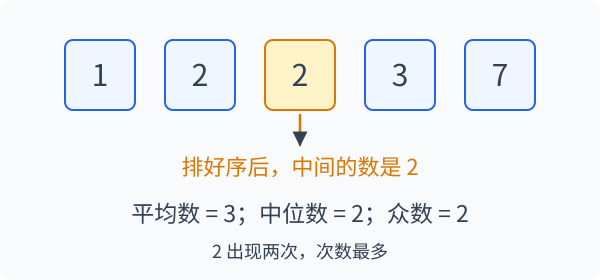

### 5. 平均数、中位数、众数的比较 {#center-choice .knowledge-title}

| 指标 | 主要反映 | 特点 |
| --- | --- | --- |
| 平均数 | 总体的平均水平 | 每个数据都会影响它 |
| 中位数 | 排序后的中间水平 | 较少受极端值影响 |
| 众数 | 最常出现的值 | 常用于尺码、规格等问题 |

### 6. 方差 {#variance .knowledge-title}

==方差==反映数据的波动程度：与平均数相比，数据分散得越开，方差越大

$$s^2=\frac{(x_1-\bar x)^2+\cdots+(x_n-\bar x)^2}{n}$$

计算顺序：求平均数 → 每个数据减平均数 → 分别平方并相加 → 除以数据个数

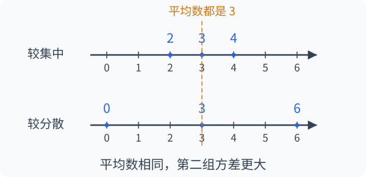

比较同一指标时，方差越小，数据越稳定

::: info 为什么把差平方

展开说明

数据与平均数的差有正有负，直接相加会抵消为 $0$。平方后都非负，再取平均，就能表示偏离的程度

:::

### 7. 标准差与极差 {#spread .knowledge-title}

- 标准差：方差的算术平方根，$s=\sqrt{s^2}$，单位与原数据相同
- 极差：最大值减最小值，只反映两端的距离

## 【考点】依定义选方法 {#exam .handbook-section .is-exam}

### 1. 每个数据统一变换，统计量怎样变 {#transform .exam-title}

若全部数据同时变为 $y_i=kx_i+a$，则

$$\bar y=k\bar x+a,\qquad y_i-\bar y=k(x_i-\bar x).$$

新离均差中的常数抵消，平方后每项乘 $k^2$，再平均仍乘 $k^2$；开非负平方根则乘 $\lvert k\rvert$。

| 数据变化 | 新平均数 | 新方差 | 新标准差 |
| --- | --- | --- | --- |
| 保持不变 | $\bar x$ | $s^2$ | $s$ |
| 每项加 $a$ | $\bar x+a$ | $s^2$ | $s$ |
| 每项乘 $k$ | $k\bar x$ | $k^2s^2$ | $\lvert k\rvert s$ |
| 每项变为 $kx+a$ | $k\bar x+a$ | $k^2s^2$ | $\lvert k\rvert s$ |

必须每一项使用相同的变换。$k$可以为0或负数：$k=0$时全部相等、方差为0；负数倍会倒转大小顺序，却不能产生负标准差。换单位也是倍乘，应先换成同一单位再比较。

### 2. 方差小表示稳定，不等于任何目的都更好 {#decision .exam-title}

- 比较同一运动员多次成绩，希望发挥稳定，通常关注较小方差，同时还要看平均成绩是否达到目标。
- 比较一批秧苗高度，平均高度相同时，方差小表示长势整齐，不是长得更高。
- 若测试目的在于区分不同人的水平，题设可能关注较大的离散程度；这与评价同一个人发挥稳定是不同问题。

只靠方差不能证明现实测试的公平、效度或最终优劣。如果平均数与方差各有优劣，题目又未给选择标准，就不能自行编出唯一最佳方案。

### 3. 拓展：四分位数与箱线图 {#boxplot .exam-title}

箱线图可用五个位置概括分布：最小值、下四分位数 $Q_1$、中位数 $Q_2$、上四分位数 $Q_3$、最大值。下面是须端取最小、最大值的简化示意：

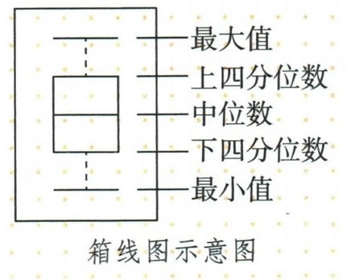

箱内横线表示中位数，箱两端分别是上下四分位数；箱长表示数值差 $Q_3-Q_1$，不是箱内人数比外部多。

一种介绍方法是把有序数据分成上下两半，再求各半的中位数。但若要具体计算，必须明确奇数个数据时原中位数是否计入两半等约定，不能只凭示意图自行选择算法。有限样本含并列值或不能均匀四等分时，“小于等于 $Q_1$ 的恰好占25%”并非无条件成立；位置分位不能直接当成严格的数值计数。

### 4. 拓展：离差平方和与连续分组 {#within-groups .exam-title}

离差平方和是不除以个数的总和，等于 $n s^2$。若将已按大小排序的 $n$ 个不同数据，限定分成前 $m$ 个与后 $n-m$ 个两组，设各组平均数为 $a,b$，可用

$$W_m=\sum_{i=1}^{m}(x_i-a)^2+\sum_{i=m+1}^{n}(x_i-b)^2$$

衡量组内的离散程度。

::: steps

1. 遍历切点 $m=1,2,\ldots,n-1$，保证两组均非空。
2. 对每个切点重新算本组平均数 $a$、$b$，不能沿用全体平均数或上一切点的平均数。
3. 各数据减自己组的平均数后平方，两组平方和相加。也可用“第一组人数×第一组方差＋第二组人数×第二组方差”。
4. 比较全部候选的 $W_m$，取最小者；若并列，保留所有达到最小的切点。

:::

这一最优性只针对“按排序连续切成两组，并使组内平方和最小”的既定目标，不代表任意现实分类都应如此。不能把两组方差直接相加替代平方和，也不能在没给具体数据时凭图猜一个切点。

### 5. 权从哪里来，先还原总量 {#weighted-method .exam-title}

把每个数值与它对应的人数、频数或评分权放在同一行。先求加权总量，再除总权；百分权和为1时可直接加贡献。合并组平均数时，以各组人数为权。

<article class="handbook-example" aria-labelledby="example-1">

#### 例题 01 人数不同的两个班怎样合并 知识清单例题 {#example-1 .example-heading}

题目

在一次数学测验中,八年级(1)(2)两班的平均成绩分别为78分、82分,其中(1)班有50人,(2)班有40人,问:两班的平均成绩是多少?

答案与解析

解析

（1）班总分为 $78\times50=3900$， （2）班为 $82\times40=3280$。两班合计90人、7180分，所以

$$\bar x=\frac{7180}{90}=\frac{718}{9}\approx79.8\text{（分）}.$$

直接算 $(78+82)/2=80$ 等于把两班人数都当成相同。人数较多的一班平均分较低，所以合并结果应略低于80，符合计算。

本题结论

约79.8分。

</article>

<article class="handbook-example" aria-labelledby="example-2">

#### 例题 02 销售量份额作权 知识清单例题 {#example-2 .example-heading}

题目

某超市销售 A, B, C, D 四种矿泉水, 它们的单价依次是 5 元、3 元、2 元、1 元. 某天的销售情况如图所示, 则这天销售的矿泉水的平均单价是 ( )

A.1.95元

B.2.15 元

C.2.25元

D.2.75元

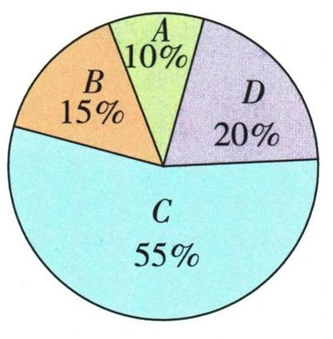

答案与解析

解析

各销量比例为10%、15%、55%、20%，总和为1，所以

$$\bar x=5\times10\%+3\times15\%+2\times55\%+1\times20\%=2.25\text{（元）}.$$

C正确。D的2.75是四种单价直接等权平均，忽略销量；A、B不符合四类贡献之和。这里用销量份额，不是收入份额。

本题结论

C，2.25元。

</article>

<article class="handbook-example" aria-labelledby="example-3">

#### 例题 03 按评分规则加权 知识清单例题 {#example-3 .example-heading}

题目

(2024 四川南充)学校举行篮球技能大赛,评委从控球技能和投球技能两方面为选手打分,各项成绩均按百分制计,然后再按控球技能占60%,投球技能占40%计算选手的综合成绩(百分制).选手李林控球技能得90分,投球技能得80分.李林综合成绩为()

A.170 分

B.86 分

C.85分

D.84 分

答案与解析

解析

控球90分对应60%，投球80分对应40%，所以综合成绩为 $90\times60\%+80\times40\%=86$ 分，选B。

A直接相加得到170，违背百分制综合；C为等权平均85，忽略权重；D为84，是把两个权交换。86在80与90之间且偏向权更大的90。

本题结论

B，86分。

</article>

### 6. 频数表求三数，分别执行三个定义 {#three-values .exam-title}

先加频数得到记录总数。平均数用值乘频数；中位数按累计频数定位中心记录；众数取最大频数所对应的值。三个指标不能共用一个“看起来在中间”的类别。

<article class="handbook-example" aria-labelledby="example-4">

#### 例题 04 投篮表中的三个统计量 知识清单例题 {#example-4 .example-heading}

题目

某中学为了解七年级女同学定点投篮水平,从中随机抽取20名女同学进行测试,每人定点投篮5次,进球数统计如下表:

| 进球数 | 0 | 1 | 2 | 3 | 4 | 5 |
| --- | --- | --- | --- | --- | --- | --- |
| 人数 | 1 | 8 | 6 | 3 | 1 | 1 |

求被抽取的 20 名女同学进球数的众数、中位数、平均数.

答案与解析

解析

总人数为 $1+8+6+3+1+1=20$。

| 进球数 | 对应排序位置 | 次数 |
| --- | --- | --- |
| 0 | 第1位 | 1 |
| 1 | 第2—9位 | 8 |
| 2 | 第10—15位 | 6 |
| 3 | 第16—18位 | 3 |
| 4 | 第19位 | 1 |
| 5 | 第20位 | 1 |

最大频数8对应进球数1，所以众数为1。第10、11位都为2，所以中位数为2。总进球为 $0\times1+1\times8+2\times6+3\times3+4\times1+5\times1=38$，平均为 $38/20=1.9$。平均1.9不要求某个人真的投进1.9球。

本题结论

众数1球，中位数2球，平均数1.9球。

</article>

<article class="handbook-example" aria-labelledby="example-5">

#### 例题 05 跳高成绩的三个结论 知识清单例题 {#example-5 .example-heading}

题目

（2024 山东滨州）在一次中学生田径运动会上,参加男子跳高的15名运动员的成绩如下表所示:

| 成绩/m | 1.50 | 1.60 | 1.65 | 1.70 | 1.75 | 1.80 |
| --- | --- | --- | --- | --- | --- | --- |
| 人数 | 2 | 3 | 2 | 3 | 4 | 1 |

某同学分析上表后得出如下结论：

①这些运动员成绩的平均数是1.65；②这些运动员成绩的中位数是1.70；③这些运动员成绩的众数是1.75.

上述结论中正确的是 （）

A.②③

B.①③

C.①②

D.①②③

答案与解析

解析

总成绩为 $1.50\times2+1.60\times3+1.65\times2+1.70\times3+1.75\times4+1.80=25$ 米，平均数 $25/15\approx1.67$ 米，①错误。

累计人数为2、5、7、10、14、15，第8位为1.70米，②正确。最大频数4对应1.75米，③正确。因此选②③，即A；其余三项都含错误的①。

本题结论

A。

</article>

### 7. 双图先恢复总量，再按频数求三数 {#double-chart .exam-title}

找到同一类的“数量＋比例”，用数量除比例求样本总数；再核各柱之和。平均数按频数加权，中位数按全部样本排序，众数看最大频数对应的值。图中的 $m\%$ 是比例，填 $m$ 时不再带百分号。

<article class="handbook-example" aria-labelledby="example-6">

#### 例题 06 麦苗的总数与典型高度 知识清单例题 {#example-6 .example-heading}

题目

农科院为了解某种小麦的长势,随机抽取了部分麦苗,对苗高(单位:cm)进行了测量.根据统计的结果,绘制出如下统计图.

请根据相关信息,解答下列问题:

(1)本次抽取的麦苗的株数为____，图①中 m 的值为____。

(2) 求统计的这组苗高的平均数、众数和中位数.

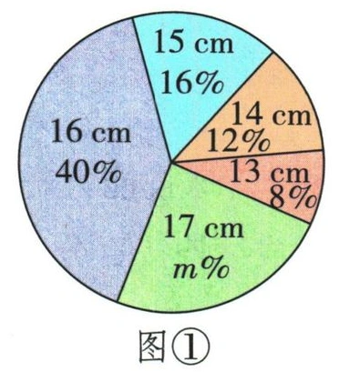

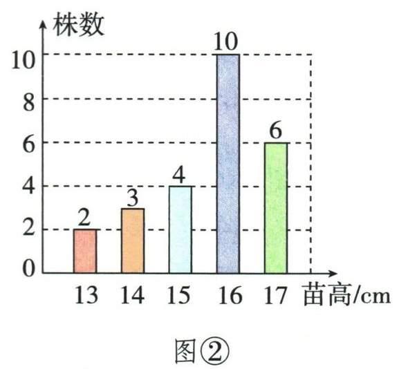

答案与解析

解析

（1）15厘米的4株占16%，总株数 $4\div16\%=25$；17厘米6株占 $6/25=24\%$，所以 $m=24$。

（2）总苗高为 $13\times2+14\times3+15\times4+16\times10+17\times6=390$ 厘米，平均 $390/25=15.6$ 厘米。16厘米出现10次最多，众数为16厘米。小于16厘米的有 $2+3+4=9$ 株，16厘米占第10—19位，25株的中心第13位在其中，中位数为16厘米。

本题结论

（1）25，24；（2）平均15.6厘米，众数16厘米，中位数16厘米。

</article>

<article class="handbook-example" aria-labelledby="example-7">

#### 例题 07 活动学生的年龄分布 知识清单例题 {#example-7 .example-heading}

题目

（2023 天津）为培养青少年的劳动意识,某校开展了剪纸、编织、烘焙等丰富多彩的活动.该校为了解参加活动的学生的年龄情况,随机调查了 a 名参加活动的学生的年龄(单位:岁).根据统计的结果,绘制出如下的统计图 1 和图 2.

请根据相关信息,解答下列问题:

(1) 填空: a 的值为 ____, 图 1 中 m 的值为 ____.

(2)求统计的这组学生年龄数据的平均数、众数和中位数.

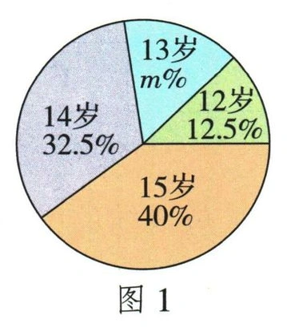

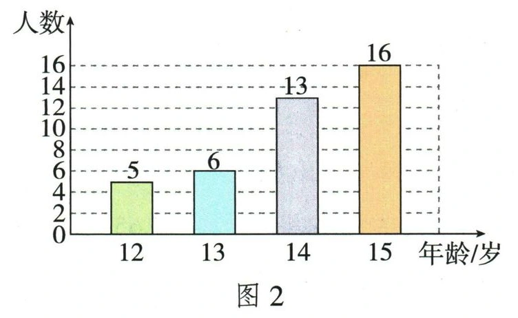

答案与解析

解析

（1）12岁的5人占12.5%，所以 $a=5\div12.5\%=40$。13岁占 $6/40=15\%$，故 $m=15$。

（2）总年龄为 $12\times5+13\times6+14\times13+15\times16=560$ 岁，平均 $560/40=14$ 岁。最多16人对应15岁，众数为15岁。12、13岁合计11人，14岁占第12—24位；40人的中心第20、21位都为14，中位数为14岁。

本题结论

（1）40，15；（2）平均14岁，众数15岁，中位数14岁。

</article>

### 8. 折线图的时间顺序，不是中位数的排序 {#ordered-values .exam-title}

先按横轴读出每条记录；求平均数直接求和，求众数统计重复值，求中位数须另按数值大小排列。即使原中间月份恰巧等于中位数，也不能省去排序理由。

<article class="handbook-example" aria-labelledby="example-8">

#### 例题 08 空气质量为优的天数 知识清单例题 {#example-8 .example-heading}

题目

（2024 江西）如图是某地去年一至六月每月空气质量为优的天数的折线统计图,关于各月空气质量为优的天数,下列结论错误的是()

A.五月份空气质量为优的天数是16

B.这组数据的众数是15天

C. 这组数据的中位数是 15 天

D.这组数据的平均数是15天

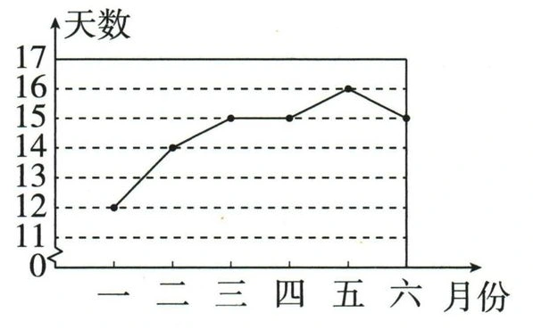

答案与解析

解析

六个月的数据为12、14、15、15、16、15。五月为16天，A正确；15出现3次最多，B正确。排序为12、14、15、15、15、16，中间两值都是15，C正确。平均数为 $87/6=14.5$ 天，不是15天，D错误。

本题结论

D。

</article>

### 9. 按中心序号检查添加数据的方案 {#median-constraint .exam-title}

当要求中位数保持某值时，分别统计严格低于、等于、严格高于该值的记录数，检查新的中心序号是否落在等值记录范围。相等值有多条时，不能机械要求两边严格等人数。

<article class="handbook-example" aria-labelledby="example-9">

#### 例题 09 增加两件后中心是否改变 知识清单例题 {#example-9 .example-heading}

题目

（2024 江苏苏州）某公司拟推出由 7 个盲盒组成的套装产品, 现有 10 个盲盒可供选择, 统计这 10 个盲盒的质量如图所示. 序号为1到5号的盲盒已选定,这5个盲盒质量的中位数恰好为100,6号盲盒从甲、乙、丙中选择1个,7号盲盒从丁、戊中选择1个,使选定7个盲盒质量的中位数仍为100,可以选择()

A.甲、丁

B.乙、戊

C.丙、丁

D.丙、戊

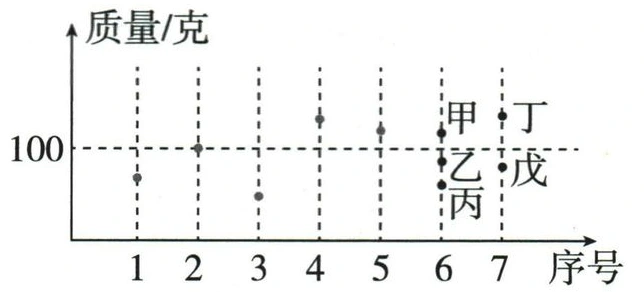

答案与解析

解析

原五件为2件低于100、1件等于100、2件高于100。图中甲、丁高于100，乙、丙、戊低于100。七件的中心是第4位：

| 选项 | 新增两件 | 100所在的位置 | 是否符合 |
| --- | --- | --- | --- |
| A：甲、丁 | 两高 | 第3位，第4位大于100 | 不符合 |
| B：乙、戊 | 两低 | 第5位，第4位小于100 | 不符合 |
| C：丙、丁 | 一低一高 | 第4位 | 符合 |
| D：丙、戊 | 两低 | 第5位 | 不符合 |

结合6号从甲、乙、丙中选一个、7号从丁、戊中选一个的限制，所有可行搭配为甲与戊、乙与丁、丙与丁。四个选项中只有C列出可行搭配。只需要图上相对于100的高低关系，不必猜每个盲盒的具体质量。

本题结论

C。

</article>

### 10. 解释典型水平，不是看到极值就删数 {#typical .exam-title}

先按定义算指标，再说明它与题目目的怎样相配。较大极值会拉高平均数，描述中间公司的典型水平时可考虑中位数；若研究总量或均分，平均数仍适用。

<article class="handbook-example" aria-labelledby="example-10">

#### 例题 10 分公司的利润水平 知识清单例题 {#example-10 .example-heading}

题目

某一企业集团有 15 个分公司, 各分公司所创年利润如下表:

| 分公司年利润/百万元 | 6 | 1.9 | 2.5 | 2.1 | 1.4 | 1.6 | 1.2 |
| --- | --- | --- | --- | --- | --- | --- | --- |
| 公司数 | 1 | 1 | 2 | 4 | 2 | 2 | 3 |

(1)计算各分公司所创年利润的平均数和中位数.
(2)在平均数和中位数中,你认为应该用哪一个来描述该集团各分公司所创年利润的一般水平?为什么?

答案与解析

解析

（1）公司数共15，总利润为

$$6+1.9+2.5\times2+2.1\times4+1.4\times2+1.6\times2+1.2\times3=30.9\text{（百万元）}.$$

平均数为 $30.9/15=2.06$ 百万元。按利润由小到大，1.2占第1—3位，1.4占第4—5位，1.6占第6—7位，1.9占第8位，故中位数为1.9百万元。

（2）仅一家利润6百万元，明显高于其他公司，拉高了平均数。描述处于中间公司的通常水平，中位数1.9百万元较合适；不应因此删去这家公司的数据，也不能说平均数失去总量意义。

本题结论

（1）平均2.06百万元，中位1.9百万元；（2）用中位数较合适，单个6百万元极值拉高平均数，中位数更贴近典型公司的水平。

</article>

### 11. 方差与极差按各自定义计算 {#spread-method .exam-title}

方差先求本组均值，再逐项作差、平方、平均；分母是记录条数。极差则只找全组最大值和最小值，不需要均值，也不除记录数。

<article class="handbook-example" aria-labelledby="example-11">

#### 例题 11 五次投壶的波动 知识清单例题 {#example-11 .example-heading}

题目

春节期间,小宇体验了投壶这一民俗活动,一共投壶5次,每次要投8支箭,投进去的箭数分别为5,2,4,3,6,则这5次投壶中投进的箭数的方差为____.

答案与解析

解析

平均数为 $(5+2+4+3+6)/5=4$。

| 投中数 | 5 | 2 | 4 | 3 | 6 |
| --- | --- | --- | --- | --- | --- |
| 与均值之差 | 1 | −2 | 0 | −1 | 2 |
| 差的平方 | 1 | 4 | 0 | 1 | 4 |

平方和为10，方差 $s^2=10/5=2$。数据为五次各自投中的支数，分母是5，不是每次投出的8支箭。若另说明标准差，它为 $\sqrt2$，但本题问方差，答案仍是2。

本题结论

2。

</article>

<article class="handbook-example" aria-labelledby="example-12">

#### 例题 12 八项记录的极差 知识清单例题 {#example-12 .example-heading}

题目

在九年级体育测试中,某班参加仰卧起坐测试的一组女生(每组8人)的测试成绩(单位:次/分)为:46,44,45,42,48,46,47,45,则这组数据的极差为____.

答案与解析

解析

全部八个数中，最大为48，最小为42，所以极差为 $48-42=6$ 次/分。列表首项46、末项45不是极端值，不能直接相减；极差也不用除以8。

本题结论

6次/分。

</article>

### 12. 比较表现，平均水平与稳定性分开看 {#stable-method .exam-title}

平均数说明整体成绩高低，方差说明围绕本组均值的波动。先核题目要求，再分别比较；一方平均更高并不自动表示更稳定。

<article class="handbook-example" aria-labelledby="example-13">

#### 例题 13 两位学生的成绩比较 知识清单例题 {#example-13 .example-heading}

题目

甲、乙两名同学五次数学测试成绩的折线图如图所示.

比较甲、乙的成绩,下列说法正确的是 ( )

A. 甲平均分高, 成绩稳定

B.甲平均分高,成绩不稳定

C.乙平均分高,成绩稳定

D.乙平均分高,成绩不稳定

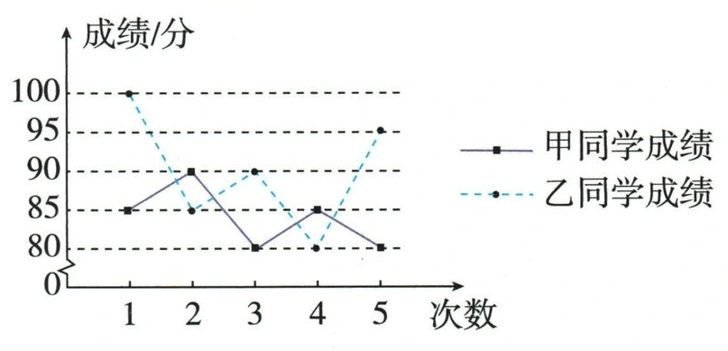

答案与解析

解析

先直接观察同一纵轴尺度下的两条折线：甲的成绩起伏较小，乙的起伏较大，因而乙较不稳定。还可以用方差作定量核验。

甲的五次成绩为85、90、80、85、80，平均为 $420/5=84$ 分；乙为100、85、90、80、95，平均为 $450/5=90$ 分。

甲离均差平方和 $1+36+16+1+16=70$，方差为14；乙为 $100+25+0+100+25=250$，方差为50。因此乙平均分高，但相对甲波动更大，D正确。A、B误判平均分，C误判稳定性。

本题结论

D。

</article>

<article class="handbook-example" aria-labelledby="example-14">

#### 例题 14 平均相同时怎样选择更稳定者 知识清单例题 {#example-14 .example-heading}

题目

某射击队为从甲、乙两名运动员中选拔一人参加全国比赛,对他们进行了8次测试,测试成绩(单位:环)如下表所示.

| 甲 | 10 | 8 | 9 | 8 | 10 | 9 | 10 | 8 |
| --- | --- | --- | --- | --- | --- | --- | --- | --- |
| 乙 | 10 | 7 | 10 | 10 | 9 | 8 | 8 | 10 |

(1)根据表格中的数据,计算出甲的平均成绩是____环,乙的平均成绩是____环.  
(2) 分别计算甲、乙两名运动员 8 次测试成绩的方差.  
(3)根据(1)(2)计算的结果,你认为推荐谁参加全国比赛更合适?并说明理由.

答案与解析

解析

（1）两人的总成绩都为72环，平均均为 $72/8=9$ 环。

（2）各数据减9后平方：

| 人员 | 八个离均平方 | 平方和 | 方差 |
| --- | --- | --- | --- |
| 甲 | 1、1、0、1、1、0、1、1 | 6 | $6/8=0.75$ |
| 乙 | 1、4、1、1、0、1、1、1 | 10 | $10/8=1.25$ |

（3）平均成绩相同，而甲方差更小，按本题追求稳定表现的目标，推荐甲。不能只选某一次最高成绩，因为两人都有10环。

本题结论

（1）9，9；（2）甲0.75，乙1.25；（3）甲，平均相同而更稳定。

</article>

<article class="handbook-example" aria-labelledby="example-15">

#### 例题 15 好且稳定，与长势整齐 知识清单例题合组，保留各原题 {#example-15 .example-heading}

题目

（1）（2024云南）甲、乙、丙、丁四名运动员参加射击项目选拔赛，每人10次射击成绩的平均数 $\bar{x}$ （单位：环）和方差 $s^2$ 如下表所示.

|  | 甲 | 乙 | 丙 | 丁 |
| --- | --- | --- | --- | --- |
| $\overline{x}$ | 9.9 | 9.5 | 8.2 | 8.5 |
| $s^{2}$ | 0.09 | 0.65 | 0.16 | 2.85 |

根据表中数据,从中选择一名成绩好且发挥稳定的运动员参加比赛,应该选择()

A.甲

B.乙

C.丙

D. 丁

（2）（2024 湖南长沙）为了比较甲、乙、丙三种水稻秧苗的长势,每种秧苗各随机抽取 40 株,分别量出每株高度,计算发现三组秧苗的平均高度一样,并且得到甲、乙、丙三组秧苗高度的方差分别是 3.6、10.8、15.8,由此可知____种秧苗长势更整齐(填“甲”“乙”或“丙”).

答案与解析

解析

（1）甲的平均数9.9为四人最高，方差0.09又为最小，同时满足成绩好与发挥稳定，选A。乙、丙、丁的平均数都较低，方差也都大于甲。

（2）三组平均高度相同，甲的方差3.6最小，波动最小，所以甲长势最整齐。整齐不代表平均高度更高，题设已经说明平均相同。

本题结论

（1）A；（2）甲。

</article>

## 【坑点】条件与目的不能省 {#pitfalls .handbook-section .is-pitfall}

### 1. 未经排序与把众数当频数 {#position-pit .pitfall-title}

中位数取排序后中心，众数取最多次数对应的值。若利用“唯一众数”反推未知数，必须排除其他值与它并列的可能。

<article class="handbook-example is-pitfall" aria-labelledby="pitfall-1">

#### 辨析 01 位置与唯一众数 知识清单例题合组；第（2）问改编，明确唯一众数口径 {#pitfall-1 .example-heading}

题目

（1）数据 1,2,4,5,3 的中位数是 ____.

（2）（2024四川南充）若一组数据6,6,m,7,7,8的唯一众数为7,则这组数据的中位数为____.

答案与解析

解析

（1）先排成1、2、3、4、5，第3位为3；原记录列表的第3个数4不能直接当中位数。

（2）已有6和7各两次。要使7成为唯一众数，只有 $m=7$，使7出现三次。排序后为6、6、7、7、7、8，中间第3、4位均为7，中位数为7。若仅说“7是众数之一”，则不能由此唯一推出 $m=7$。

本题结论

（1）3；（2）7。

</article>

### 2. 中位数不能解决所有同分排名 {#ranking-pit .pitfall-title}

排序位置与数值大小不是同一件事。同一个成绩可占据多个名次，若同分跨过获奖线，只知道中位数并不足以判定具体个人。

<article class="handbook-example is-pitfall" aria-labelledby="pitfall-2">

#### 辨析 02 统计量的用途与获奖边界 依据知识清单例题改编，保原问并补检同分条件 {#pitfall-2 .example-heading}

题目

根据下列情况,选择合适的统计量填空.

(1)某次数学竞赛,45人进入复赛,其中前22名都能获奖,小明已经查出自己的成绩,他想判断自己是否获奖,只需知道45人复赛成绩的____.

(2)某专卖店专营某品牌的衬衫,店主对上一周中不同尺码的衬衫销售量情况进行统计,影响该店主决定本周进货时,多进某种尺码衬衫的统计量是____.

请对第（1）问同时检查同分时，“只需知道”是否仍充分。

答案与解析

解析

（1）通常先看中位数。45人的中位数是由低到高第23位。成绩严格高于它的至多22人，小明若严格高于中位数，处于获奖的一侧；严格低于则不能进前22。若恰等于中位数，并有人同分跨越获奖边界，仅凭中位数不能判断，还须知道同分排名规则。因此“只需知道”不是所有同分情形下都充分。

（2）应看众数，即上周售出最多的尺码。这是最常见规格的问题，不是把各尺码求平均的问题。

本题结论

（1）参考中位数，但等于中位数且同分跨界时还需规则；（2）众数。

</article>

### 3. 方差的大小，要放回统计目的 {#purpose-pit .pitfall-title}

同一个人多次发挥的稳定性，与一群人的成绩能否拉开差异，统计对象和目标都不同。不能把“越小越稳定”改成“越小在任何情况下都越好”。

<article class="handbook-example is-pitfall" aria-labelledby="pitfall-3">

#### 辨析 03 选拔测试的参考意义 知识清单例题 {#pitfall-3 .example-heading}

题目

学校为了选拔4名播音员，对20名学生进行了两次普通话水平测试，满分10分，经统计与计算知，第一次测试结果的方差为 $s_{1}^{2}=1.2275$ ，第二次测试结果的方差为 $s_{2}^{2}=1.3475$ 。问哪次测试结果对选拔播音员更有参考意义？

答案与解析

解析

统计对象是20名不同学生的同次测试成绩，不是同一个人的反复发挥。第二次方差 $1.3475>1.2275$，成绩较分散。在题设用离散程度作为区分水平参考的模型下，第二次更有参考意义。

这不等于说第二次“更稳定”，也不能单凭方差证明真实测试更公平、更有效，或确定前四名的具体差距。

本题结论

按题设的区分度指标，第二次。

</article>

### 4. 删除一个值，平均数与方差未必同变 {#deletion-pit .pitfall-title}

设 $n>1$，一组不全相同的数据中有一项恰等于原平均数。删除这一项后：

| 统计量 | 是否改变 | 依据 |
| --- | --- | --- |
| 平均数 | 不变 | 总和与个数同时减去一个平均份额 |
| 离差平方和 | 不变 | 删除项的离均平方为0，其余均值未变 |
| 方差 | 增大 | 同一正平方和由除$n$变为除$n-1$ |
| 极差 | 不变 | 非全相同时均值严格在最大、最小之间，删除它不删极端 |

删除等于中位数的数据也须保证剩余非空，并检查极端仍然保留，才能讨论极差不变。删到空组时，平均数、中位数、极差均不能照常计算。

极差与分组范围还要相容：若极差为83，组距为10，8组只能覆盖长度80，不能覆盖全部数据；至少需9组，具体端点仍须按实际起点做到不重不漏。
