统计先回答“研究谁的什么”，再决定怎样收集和表示数据。图表能帮助看清数量、组成与变化，却不能补救抽样范围错误，也不能替代对刻度和分母的核查。

<nav class="handbook-nav" aria-label="本章分区">
  <a class="handbook-jump is-knowledge" href="#knowledge">01 · 知识点概念、关系与适用条件</a>
  <a class="handbook-jump is-exam" href="#exam">02 · 考点题目分类和例题</a>
  <a class="handbook-jump is-pitfall" href="#pitfalls">03 · 坑点辨析错因，检查遗漏</a>
</nav>

## 【知识点】对象、数据与图表 {#knowledge .handbook-section .is-knowledge}

### 1. 统计调查 {#survey .knowledge-title}

明确问题 → 收集数据 → 整理数据 → 用图表表示 → 分析结果

例如研究学生的上学方式，先说清调查哪所学校、哪些学生，再记录步行、骑车、乘车等情况

### 2. 全面调查与抽样调查 {#survey-types .knowledge-title}

- 全面调查：调查全部对象，如检查全班每人的作业
- 抽样调查：调查一部分对象来估计总体，如抽检一批灯泡的使用寿命

### 3. 总体、个体、样本、样本容量 {#population .knowledge-title}

调查全校学生的身高，抽取 $100$ 名学生

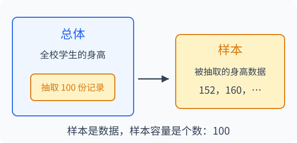

| 名称 | 本例中指什么 |
| --- | --- |
| 总体 | 全校学生的身高 |
| 个体 | 每名学生的身高 |
| 样本 | 抽取的 $100$ 名学生的身高 |
| 样本容量 | $100$，是个数，不带单位 |

### 4. 随机抽样 {#sampling .knowledge-title}

简单随机抽样使每个个体有相同的被抽机会，例如编号后抽签。样本应有代表性，容量应适当

### 5. 频数与频率 {#frequency .knowledge-title}

某类数据出现的次数叫作==频数==，频数与总次数的比叫作==频率==

$$\text{频率}=\frac{\text{频数}}{\text{数据总数}}$$

例如 $10$ 人中有 $6$ 人步行，频数为 $6$，频率为 $\frac6{10}=60\%$

### 6. 常用统计图 {#charts .knowledge-title}

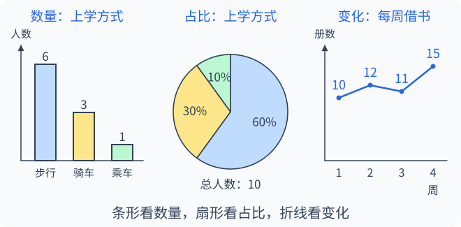

- 条形图：比较各类的数量
- 扇形图：表示各部分占总体的比例
- 折线图：表示数量随时间等有序变量的变化

### 7. 扇形图的圆心角 {#sectors .knowledge-title}

$$\text{圆心角}=360^\circ\times\text{所占比例}$$

例如占比 $60\%$ 的扇形，圆心角为 $216^\circ$；各部分比例相加为 $100\%$

### 8. 分组与组距 {#grouping .knowledge-title}

把连续数据分成若干区间，每组上下端点之差叫作==组距==。例如 $60\le x<70$ 的组距为 $10$

各组要不重不漏，如 $70$ 归入 $70\le x<80$，不再归入前一组

### 9. 频数分布直方图 {#histogram .knowledge-title}

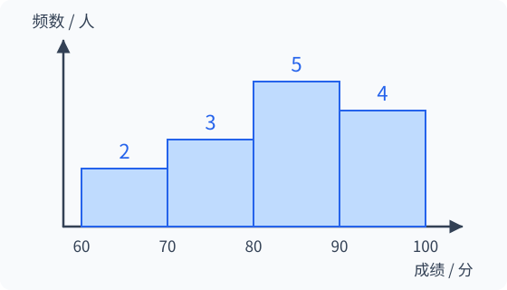

横轴表示数值区间，等组距、纵轴为频数时，柱高就是该组的频数

若纵轴标的是“频数÷组距”，则用“柱高×组距”求频数

## 【考点】先定口径，再读算 {#exam .handbook-section .is-exam}

### 1. 趋势是统计关系，不是每一点都满足的等式 {#trend .exam-title}

趋势图用一条直线或曲线概括两个量之间的统计变化倾向。下面的观测点大体由左下向右上，支持在这组数据范围内，最高气温较高时冷饮销量通常较多。

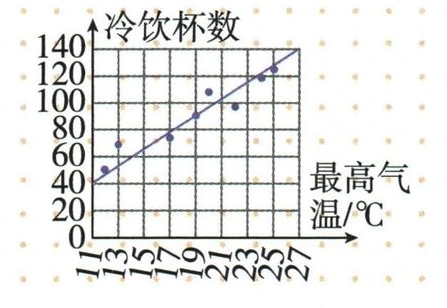

实际点可以偏离趋势线，同一气温下客流、营业时间等也可能不同。因此不能把线上的值当作每次必然出现的销量，不能凭相关图断言气温单独造成全部变化，更不能没有明确模型就随意向数据范围外作精确预测。

### 2. 选择调查方式，按目的排优先级 {#choose-survey .exam-title}

先问是否必须掌握每个个体，再问测试是否会损坏或耗尽对象，最后考虑范围与资源。解释每个选项触发了哪条条件，而不是只背规模大小。

<article class="handbook-example" aria-labelledby="example-1">

#### 例题 01 五种调查的选择 知识清单例题 {#example-1 .example-heading}

题目

下列调查中,适合采用全面调查的有____,适合采用抽样调查的有____.(填序号)
①调查全班同学的身高情况;
②调查全省中学生的身高情况;
③调查某批圆珠笔笔芯的使用寿命;
④调查乘坐飞机的旅客是否携带了违禁物品;
⑤调查某城市的空气质量.

答案与解析

解析

①全班身高范围小，且要掌握全班情况，适合全面；④安检必须逐人排查，也适合全面。②全省范围很广，③笔芯寿命试验耗尽产品，⑤空气质量不能遍测全城每一点每一时刻，适合选取有代表性的样本。

本题结论

全面调查①④；抽样调查②③⑤。

</article>

<article class="handbook-example" aria-labelledby="example-2">

#### 例题 02 方式是否符合调查目的 知识清单例题 {#example-2 .example-heading}

题目

下列采用的调查方式中,合适的是

( )

A.为了解东江湖的水质情况,采用抽样调查的方式

B. 我市某企业为了解所生产的产品的合格率,采用全面调查的方式

C. 某小型企业给在职员工做工作服前进行尺寸大小的调查,采用抽样调查的方式

D. 某市教育部门为了解该市中小学生的视力情况,采用全面调查的方式

答案与解析

解析

A以适当采样了解湖水总体状况，合适。B在本题一般合格率调查情境中，抽样较经济；若实际任务是逐件验收，策略可以改变。C工作服需要每位员工本人的尺寸，不能以样本尺寸代替；D为了解全市学生总体视力状况，范围广，通常用抽样。

本题结论

A。

</article>

<article class="handbook-example" aria-labelledby="example-3">

#### 例题 03 普查的适用情形 知识清单例题 {#example-3 .example-heading}

题目

（2024江苏镇江）下列各项调查适合普查的是 （）

A.长江中现有鱼的种类

B. 某班每位同学视力情况

C. 某市家庭年收支情况

D. 某品牌灯泡使用寿命

答案与解析

解析

A长江鱼类与C全市家庭收支涉及范围广，适合抽样；D灯泡寿命试验有破坏性，也宜抽样。B对象为一班每位学生，范围小且需要每人结果，适合普查。

本题结论

B。

</article>

### 3. 四个概念，只换范围不换指标 {#identify-population .exam-title}

圈出“研究什么”，再分别写全体、一个、被抽部分及纯个数。若题目强调具体指标，就不能只保留“学生”或“考生”而省去成绩、身高、意见。

<article class="handbook-example" aria-labelledby="example-4">

#### 例题 04 样本、容量与调查指标 知识清单例题合组，保留各原题 {#example-4 .example-heading}

题目

（1）某校为了解家长对“禁止学生带手机进入校园”这一规定的意见,随机对全校100名学生的家长进行调查,这一问题中样本是____.

（2）今年某市有4万名考生参加中考,为了解这些考生的中考数学成绩,从中抽取2000名考生的中考数学成绩进行统计分析,在这个问题中,下列说法:①这4万名考生的中考数学成绩是总体;②每名考生是个体;③2000名考生是总体的一个样本;④样本容量是2000.其中正确的有()

A.4 个

B.3 个

C.2 个

D.1 个

（3）(2023 山东聊城)4 月 15 日是全民国家安全教育日.某校为了摸清该校 1 500 名师生的国家安全知识掌握情况,从中随机抽取了 150 名师生进行问卷调查.这项调查中的样本是 ( )

A.1 500 名师生的国家安全知识掌握情况

B.150

C.从中抽取的150名师生的国家安全知识掌握情况

D.从中抽取的150名师生

答案与解析

解析

（1）研究的是家长的意见，样本为被抽取100名学生家长的意见，样本容量为100，不是100名学生。

（2）①全部数学成绩是总体，④2000是样本容量，正确；②、③没有写所考察的数学成绩，不符合本题完整表述。因此正确的有2个，选C。

（3）A为总体，B为容量，D省略所调查的知识掌握情况，C才是所抽150名师生的知识掌握情况。

本题结论

（1）被抽取100名学生家长的意见；（2）C；（3）C。

</article>

### 4. 合目标频数，再求频率或估总体 {#estimate .exam-title}

先分清总体数和样本数。按题设端点圈出目标类别，合目标频数，再除样本容量；若要求总体数量，最后乘总体数。结果检查不超总体，并使用“估计”而非“必有”。

<article class="handbook-example" aria-labelledby="example-5">

#### 例题 05 相邻两档的频率 知识清单例题 {#example-5 .example-heading}

题目

某校对七年级全体学生进行了一次视力普查,得到如下统计表,则视力 x 在 $4.9 \leqslant x < 5.5$ 这个范围内的频率为 ____.

| 视力x | 4.0≤x<4.3 | 4.3≤x<4.6 | 4.6≤x<4.9 | 4.9≤x<5.2 | 5.2≤x<5.5 |
| --- | --- | --- | --- | --- | --- |
| 频数 | 20 | 40 | 70 | 60 | 10 |

答案与解析

解析

目标范围恰由后两档合成，频数为 $60+10=70$。数据总数为 $20+40+70+60+10=200$，所以频率为 $70/200=0.35$。5.2只进入最后一档，不能重复计数。

本题结论

0.35。

</article>

<article class="handbook-example" aria-labelledby="example-6">

#### 例题 06 由样本比例估计人数与只数 知识清单例题合组，保留各原题 {#example-6 .example-heading}

题目

（1）为了解某区初中学生的视力情况,随机抽取了该区500名初中学生进行调查.整理样本数据,得到下表:

| 视力 | 4.7以下 | 4.7 | 4.8 | 4.9 | 4.9以上 |
| --- | --- | --- | --- | --- | --- |
| 人数 | 102 | 98 | 80 | 93 | 127 |

根据抽样调查结果,估计该区 12 000 名初中学生视力不低于 4.8 的人数是 ____.

（2）（2024 贵州）为了解学生的阅读情况,某校在 4 月 23 日世界读书日,随机抽取 100 名学生进行阅读情况调查,每月阅读两本以上经典作品的有 20 名学生,估计该校 800 名学生中每月阅读经典作品两本以上的人数为 ( )

A.100

B.120

C.150

D.160

（3）(2023 北京) 某厂生产了 1 000 只灯泡. 为了解这 1 000 只灯泡的使用寿命, 从中随机抽取了 50 只灯泡进行检测, 获得了它们的使用寿命(单位: 小时), 数据整理如下:

| 使用寿命 | $x < 1\,000$ | $1\,000 \leqslant x < 1\,600$ | $1\,600 \leqslant x < 2\,200$ | $2\,200 \leqslant x < 2\,800$ | $x \geqslant 2\,800$ |
| --- | --- | --- | --- | --- | --- |
| 灯泡只数 | 5 | 10 | 12 | 17 | 6 |

根据以上数据,估计这 1 000 只灯泡中使用寿命不小于 2 200 小时的灯泡的数量为 ____ 只.

答案与解析

解析

| 小问 | 样本中符合条件的数量 | 样本频率 | 估计总体数量 |
| --- | --- | --- | --- |
| （1） | $80+93+127=300$ | $300/500=0.6$ | $12000\times0.6=7200$人 |
| （2） | 20 | $20/100=0.2$ | $800\times0.2=160$人，选D |
| （3） | $17+6=23$ | $23/50=0.46$ | $1000\times0.46=460$只 |

“不低于4.8”包含等于4.8的那一档；“不小于2200”包含2200。第二问的20人按原调查的“两本以上”类别统计，不另改分类。三个结果都是由样本推断的估计量。

本题结论

（1）约7200人；（2）D，约160人；（3）约460只。

</article>

<article class="handbook-example" aria-labelledby="example-7">

#### 例题 07 从直方图读取目标频数 知识清单例题 {#example-7 .example-heading}

题目

为了解某中学300名男生的身高情况,随机抽取50名男生进行身高测量,将所得数据整理后,画出频数分布直方图(如图),估计该校男生的身高在174.5—179.5cm的人数为____.

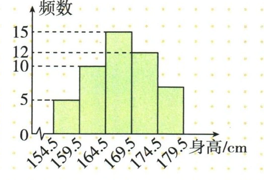

答案与解析

解析

横轴是身高区间，纵轴是频数。前四组频数为5、10、15、12，样本总数为50，因此末组频数应为 $50-(5+10+15+12)=8$。图中末柱的绘制高度不够准确，应以给定总数与其余频数核算，不能只凭视觉估读末柱。于是估计人数为

$$300\times\frac8{50}=48\text{（人）}.$$

不能把横轴的区间端点另当作一组，也不能把估计人数与样本中8人混淆。

本题结论

约48人。

</article>

### 5. 按主要表达目的选图 {#choose-chart .exam-title}

先辨主要比较的是类别数量、整体组成，还是按时间等有序变量的变化。一个问题可用多个图互补，但不能把没有自然先后顺序的类别折线当成时间趋势。

<article class="handbook-example" aria-labelledby="example-8">

#### 例题 08 三类信息各用什么图 知识清单例题 {#example-8 .example-heading}

题目

下列情况中,宜采用扇形图的是____,宜采用条形图的是____,宜采用折线图的是____.

①为了直观介绍空气中各成分的百分比；  
②为清楚地反映近三年某中学毕业生人数的变化情况；  
③为清楚地表示某中学各年级学生的人数.

答案与解析

解析

①空气成分百分比突出同一整体的组成，用扇形图；③各年级人数突出分类数量，用条形图；②连续三年毕业生人数突出时间变化，用折线图。

本题结论

扇形图①；条形图③；折线图②。

</article>

### 6. 扇形题逐项核数量、比例与角度 {#sector-method .exam-title}

比例、人数与角度不是同一个数。先确认圆所表示的总体，再使用 $f=nr$ 和 $\theta=360^\circ r$；判断调查方式时看是否调查全体，不看画了什么图。

<article class="handbook-example" aria-labelledby="example-9">

#### 例题 09 扇形所对应的圆心角 知识清单例题 {#example-9 .example-heading}

题目

下图为某企业根据对生产产品质量评测的结果绘制的扇形图.其中,质量“良好”部分所对应的圆心角为____°.

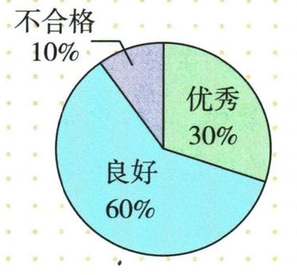

答案与解析

解析

良好占60%，所以圆心角为 $360^\circ\times60\%=216^\circ$。另两类角为108°、36°，三角相加360°，可核验。

本题结论

216°。

</article>

<article class="handbook-example" aria-labelledby="example-10">

#### 例题 10 节目喜爱情况的四种说法 知识清单例题 {#example-10 .example-heading}

题目

（2024山东济宁）为了解全班同学对新闻、体育、动画、娱乐、戏曲五类节目的喜爱情况，班主任对全班50名同学进行了问卷调查（每名同学只选其中的一类），依据50份问卷调查结果绘制了全班同学喜爱节目情况扇形统计图(如图所示).下列说法正确的是 （）

A.班主任采用的是抽样调查

B.喜爱动画节目的同学最多

C. 喜爱戏曲节目的同学有 6 名

D.“体育”对应扇形的圆心角为 $72^{\circ}$

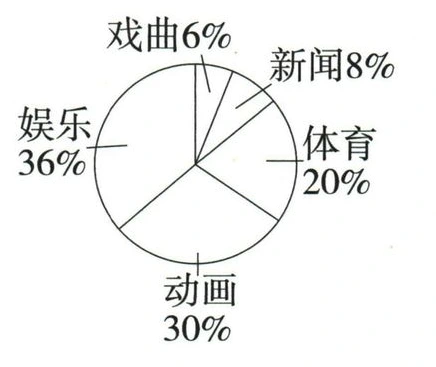

答案与解析

解析

A：调查了全班50人，是全面调查，不是抽样。B：娱乐36%多于动画30%，动画不是最多。C：戏曲占6%，人数为 $50\times6\%=3$，不是6。D：体育圆心角为 $360^\circ\times20\%=72^\circ$，正确。

本题结论

D。

</article>

### 7. 读最大、最小与超过阈值，逐条核记录 {#read-chart .exam-title}

先读图题、横纵轴和单位，再注意题目问“正确”还是“错误”。数超过某值的月份或年份，应数离散记录，不数折线跨越水平线的线段。

<article class="handbook-example" aria-labelledby="example-11">

#### 例题 11 阅读量的最大值与阈值 知识清单例题 {#example-11 .example-heading}

题目

某校七(2)班班长统计了今年 1—8 月“书香校园”活动中全班同学的课外阅读数量(单位:本),绘制了如下折线图,下列说法错误的是 ( )

A. 阅读量最多的是 8 月份

B. 阅读量最少的是6月份

C.3月份和5月份的阅读量相等

D. 阅读量超过 40 本的有 5 个月

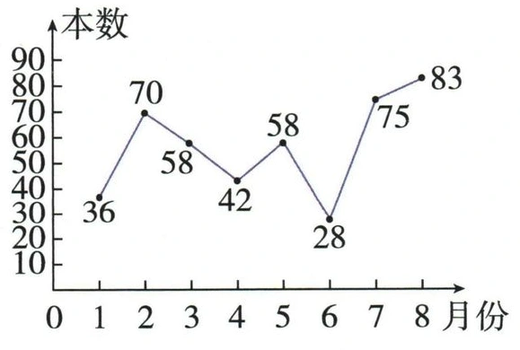

答案与解析

解析

八个月依次为36、70、58、42、58、28、75、83本。A中8月83最多，B中6月28最少，C中3月和5月都是58，均正确。超过40的是2、3、4、5、7、8月，共6个月，D称5个月错误。

本题结论

D。

</article>

<article class="handbook-example" aria-labelledby="example-12">

#### 例题 12 首次超过某个数值的年份 知识清单例题 {#example-12 .example-heading}

题目

（2024甘肃）近年来，我国重视农村电子商务的发展.下面的统计图反映了2016—2023年中国农村网络零售额情况.根据统计图提供的信息，下列结论错误的是 （）

2016—2023年中国农村网络零售额统计图

A.2023年中国农村网络零售额最高

B.2016年中国农村网络零售额最低

C.2016—2023年,中国农村网络零售额持续增加

D.从 2020 年开始,中国农村网络零售额突破 20 000 亿元

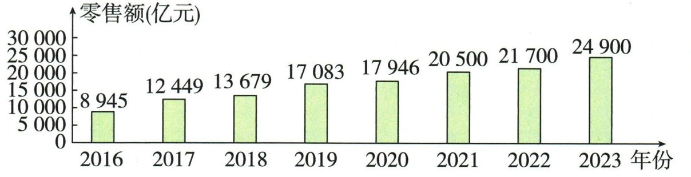

答案与解析

解析

在图示年份范围内，2023年24900最高，2016年8945最低；各相邻年数值依次增加，所以A、B、C正确。2020年为17946，尚未超过20000；2021年20500才超过，D错误。结论只针对图给的2016—2023年范围。

本题结论

D。

</article>

### 8. 直方图先核分组端点和总频数 {#histogram-method .exam-title}

先看纵轴是频数还是密度，再恢复缺失数据。最多、最少按人数比较；“超过”与“不小于”边界不同。缺画的柱可能是待补未知量，不应直接当作0。

<article class="handbook-example" aria-labelledby="example-13">

#### 例题 13 公园面积的频数分布 知识清单例题 {#example-13 .example-heading}

题目

（2024 广东广州）为了解公园用地面积 x（单位：公顷）的基本情况，某地随机调查了本地 50 个公园的用地面积，按照 $0 < x \leqslant 4, 4 < x \leqslant 8, 8 < x \leqslant 12, 12 < x \leqslant 16, 16 < x \leqslant 20$ 的分组绘制了如图所示的频数分布直方图，下列说法正确的是（）

A.a 的值为 20

B.用地面积在 $8 < x \leqslant 12$ 这一组的公园个数最多

C. 用地面积在 $4 < x \leqslant 8$ 这一组的公园个数最少

D.这50个公园中有一半以上的公园用地面积超过12公顷

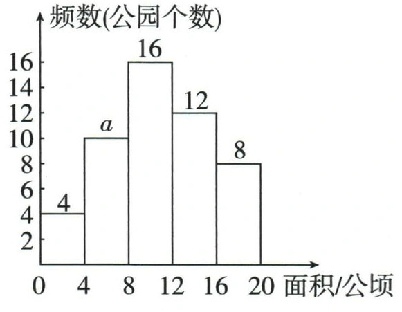

答案与解析

解析

总频数为50，因此 $a=50-4-16-12-8=10$，A错误。五组频数为4、10、16、12、8，第三组 $8<x\le12$ 最多，B正确；最少的是第一组，C错误。超过12只计末两组，共20个，占40%，不足一半，D错误。恰为12的公园属于第三组，不计入“超过12”。

本题结论

B。

</article>

### 9. 两张图连用，先找共同类别与共同总数 {#combined .exam-title}

若一类同时给出数量和频率，可反求总数；若图给各月总量与各月占比，要逐月相乘，不能拿五个月合计作每个月的分母。补图须保留原轴与尺度，并标出补入数值。

<article class="handbook-example" aria-labelledby="example-14">

#### 例题 14 每个月的百分比属于哪个总量 知识清单例题 {#example-14 .example-heading}

题目

图1表示的是某书店今年1—5月的各月营业总额的情况,图2表示的是该书店“党史”类书籍的各月营业额占书店当月营业总额的百分比情况.若该书店1—5月的营业总额一共是182万元,观察图1、图2,解答下列问题:

(1) 求该书店 4 月份的营业总额, 并补全条形图.  
(2) 求 5 月份“党史”类书籍的营业额.  
(3)请你判断这5个月中哪个月“党史”类书籍的营业额最高,并说明理由.

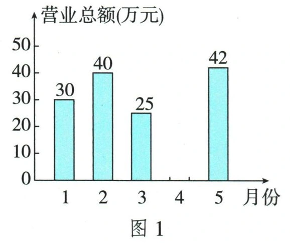

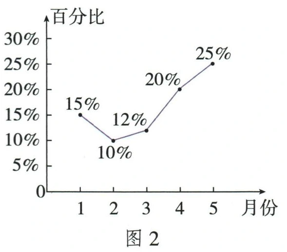

答案与解析

解析

（1）其余月份合计 $30+40+25+42=137$ 万元，4月为 $182-137=45$ 万元。按原尺度补45高的柱并标数。

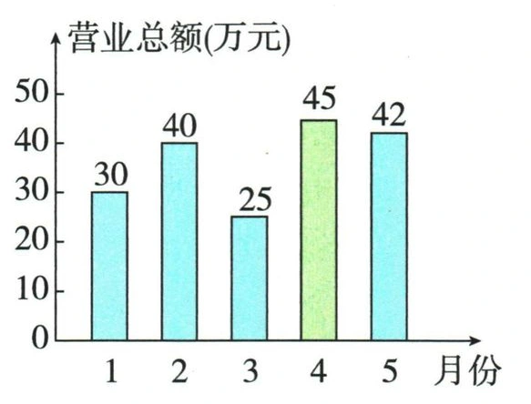

（2）5月这类书籍营业额为 $42\times25\%=10.5$ 万元。

（3）逐月计算如下：

| 月份 | 1月 | 2月 | 3月 | 4月 | 5月 |
| --- | --- | --- | --- | --- | --- |
| 该类营业额/万元 | $30\times15\%=4.5$ | $40\times10\%=4$ | $25\times12\%=3$ | $45\times20\%=9$ | $42\times25\%=10.5$ |

所以5月最高。每个月的百分比都以本月总营业额为分母，仅比较百分比不能普遍得出绝对数量大小。

也可以先排除1—3月：这三个月各自的营业总额和党史类占比，都分别小于4月、5月的对应量。两因子均为正且分别较小，它们的乘积也较小，故只需再比较4月的9万元与5月的10.5万元。这里用的是两个因子同时比较，不是单凭占比判断。

本题结论

（1）45万元，补图见解析；（2）10.5万元；（3）5月。

</article>

<article class="handbook-example" aria-labelledby="example-15">

#### 例题 15 用同一类人数与比例补全双图 知识清单例题 {#example-15 .example-heading}

题目

（2024江苏苏州）某校计划在七年级开展阳光体育锻炼活动，开设以下五个球类项目：A（羽毛球），B（乒乓球），C（篮球），D（排球），E（足球），要求每位学生必须参加，且只能选择其中一个项目。为了了解学生对这五个项目的选择情况，学校从七年级全体学生中随机抽取部分学生进行问卷调查，对调查所得到的数据进行整理、描述和分析，部分信息如下：

各项目选择人数条形统计图

各项目选择人数占比扇形统计图

根据以上信息,解决下列问题:

(1) 将图①中的条形统计图补充完整(画图并标注相应数据).  
(2)图②中项目 E 对应的圆心角的度数为____°。  
(3) 根据抽样调查结果, 请估计本校七年级 800 名学生中选择项目 B(乒乓球) 的人数.

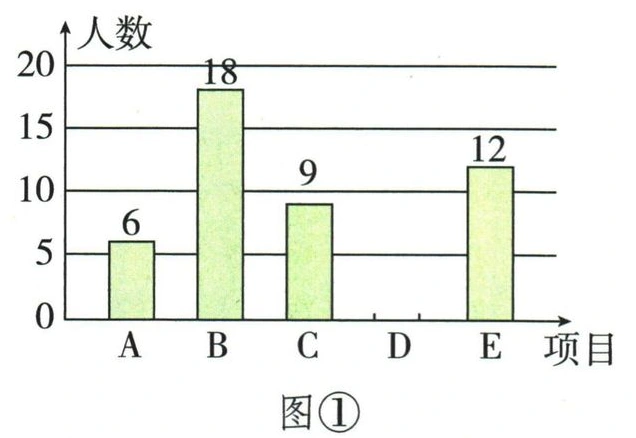

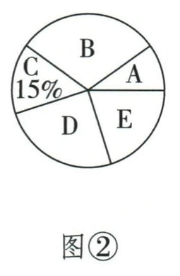

答案与解析

解析

（1）篮球C的9人占15%，所以样本总数 $n=9\div15\%=60$。排球D的人数为 $60-6-18-9-12=15$，补15高的柱。

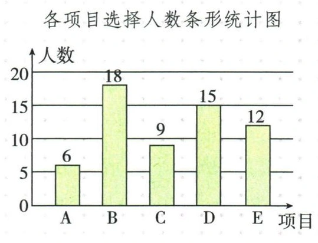

（2）E占 $12/60=20\%$，所对圆心角为 $360^\circ\times20\%=72^\circ$。

（3）B占 $18/60=30\%$，估计800人中有 $800\times30\%=240$ 人选择B。五类互斥且覆盖全体，人数和60，比例和100%，两个图使用同一个样本总数。

本题结论

（1）D为15人，补图见解析；（2）72°；（3）约240人。

</article>

## 【坑点】检查范围、尺度和分母 {#pitfalls .handbook-section .is-pitfall}

### 1. 只在方便接触的人里随机，仍可能偏样 {#sampling-pit .pitfall-title}

先检查谁没有机会入样本，再看是否随机与人数多少。扩大有偏渠道里的样本量，不等于扩大了对总体的覆盖。

<article class="handbook-example is-pitfall" aria-labelledby="pitfall-1">

#### 辨析 01 三种抽样是否合适 知识清单三条辨析，展开理由 {#pitfall-1 .example-heading}

题目

判断下列调查方式是否合适，并说明理由。

（1）为了解老年人对互联网的使用情况，在网上发放800份问卷。

（2）为了解青少年视力情况，在视力矫正中心随机抽取50名青少年。

（3）为了解全市中学生跳绳情况，在市内随机抽取900名中学生。

答案与解析

解析

（1）不合适：不上网的老人没有机会作答，恰好漏掉研究指标相关的一类人，800份不能消除此偏差。

（2）不合适：矫正中心的人群本来就偏向有视力问题者，中心内部随机不代表全体青少年。

（3）按题设在全市中学生范围内随机抽样，范围与总体一致，是合适方式。但随机样本仍有偶然误差，不能承诺每次样本比例都精确等于总体比例。

本题结论

（1）不合适；（2）不合适；（3）合适。

</article>

### 2. 视觉斜率与真实增量不是同一件事 {#scale-pit .pitfall-title}

不同图的纵轴起点、刻度或画布比例可能不同。比较同一时间长度内的增长，先读原值再作差；若问增长率，还须把增量除以前期值。

<article class="handbook-example is-pitfall" aria-labelledby="pitfall-2">

#### 辨析 02 两家公司谁增长更快 知识清单例题 {#pitfall-2 .example-heading}

题目

（2024 江苏盐城）甲、乙两家公司 2019—2023 年的利润统计图如下, 比较这两家公司的利润增长情况知 ( )

甲公司

乙公司

A.甲始终比乙快

B.甲先比乙慢，后比乙快

C.甲始终比乙慢

D.甲先比乙快，后比乙慢

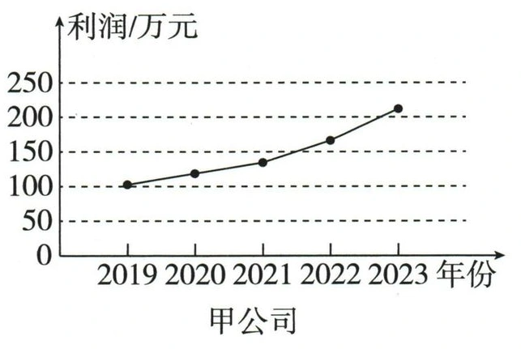

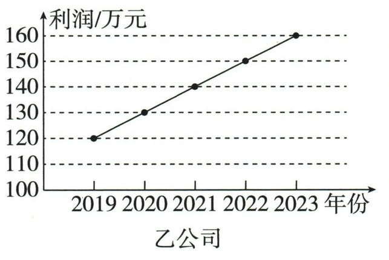

答案与解析

解析

| 公司 | 由图比较相邻年份 | 四个一年间隔的增量 |
| --- | --- | --- |
| 甲 | 纵轴相邻标线间隔50万元；各段增加量均大于这一间隔的五分之一 | 均大于10万元 |
| 乙 | 相邻年份恰上升一个10万元的刻度间隔 | 每年10万元 |

按题图比较，每个相同时间间隔内，甲增量都大于10万元，而乙每年增加10万元，所以A正确；B、C、D都不符。甲图未逐点标出精确利润，不必硬读成一串精确数。乙图视觉上陡，与它的纵轴刻度和截轴有关。

本题结论

A。

</article>

### 3. 比例比较必须带着分母 {#proportion-pit .pitfall-title}

“份额大”和“数量大”只有在总量条件合适时才能联系；“柱高成正比”也要核图的零点与尺度。

<article class="handbook-example is-pitfall" aria-labelledby="pitfall-3">

#### 辨析 03 两条看似直观的判断 知识清单两条辨析，展开条件 {#pitfall-3 .example-heading}

题目

判断正误，并说明缺少什么条件。

（1）条形图中，条形柱的高度与相应的数量一定成正比。

（2）在两个扇形图中，部分A所占百分比比部分B大，那么A的数量一定大于B的数量。

答案与解析

解析

（1）错误。相同尺度且从零起画的柱高才与数值成正比；若截去轴的底部，画出的高度比会改变。

（2）错误。两图整体总量可能不同，实际数量分别为各自总量乘各自占比。只比较百分数，缺少两个总量之间的关系。

本题结论

两条均错误；（1）核零点与尺度；（2）核各自总量。

</article>

### 4. 分组不能重漏，空频与缺图不能混淆 {#grouping-pit .pitfall-title}

| 容易误用的说法 | 应怎样检查 |
| --- | --- |
| $1\le x\le10$ 与 $10\le x\le20$ 可直接作相邻组 | 10被重复计入，须调整等号归属 |
| $1<x<10$ 与 $10<x<20$ 已覆盖中间范围 | 10无处可入，出现遗漏 |
| 没画柱就表示频数0 | 先看题目是否要求补图；未知不等于零 |
| 分组中不能出现频数0 | 空频组可以存在，连续范围不能随意删去 |
| 所有直方图都能把柱高直接相加求总数 | 仅纵轴直接为频数时成立；密度图须先乘各组组距 |

分组可以不等距，但应连续覆盖有效范围；同一数据只入一组。直方图不是“所有类别都隔开”的条形图。每次完成表或图，都回查原数据总数。
