概率研究在给定条件下，一件事发生的可能性有多大。先确定试验规则和完整结果，再选择计数、几何度量或频率估计；同一个分数，不能脱离条件解释。

<nav class="handbook-nav" aria-label="本章分区">
  <a class="handbook-jump is-knowledge" href="#knowledge">01 · 知识点概念、关系与适用条件</a>
  <a class="handbook-jump is-exam" href="#exam">02 · 考点题目分类和例题</a>
  <a class="handbook-jump is-pitfall" href="#pitfalls">03 · 坑点辨析错因，检查遗漏</a>
</nav>

## 【知识点】概念、条件与模型 {#knowledge .handbook-section .is-knowledge}

### 1. 必然事件、不可能事件与随机事件 {#events .knowledge-title}

| 类型 | 含义 | 掷一枚普通六面骰子 |
| --- | --- | --- |
| 必然事件 | 一定发生 | 点数小于 $7$ |
| 不可能事件 | 一定不发生 | 点数为 $7$ |
| 随机事件 | 可能发生，也可能不发生 | 点数为 $6$ |

必然事件与不可能事件合称确定性事件

### 2. 概率 {#classical .knowledge-title}

事件发生的可能性大小，用==概率==表示，记作 $P(A)$，范围为 $0\le P(A)\le1$

在有限种结果都等可能时

$$P(A)=\frac{\text{满足事件 A 的结果数}}{\text{全部可能的结果数}}$$

例如掷均匀骰子，出现偶数的结果有 $2,4,6$，所以概率为 $\frac36=\frac12$

### 3. 列表法与树状图 {#enumeration .knowledge-title}

把所有结果列出来，再数符合条件的结果。两个步骤可用列表法，多步可用树状图

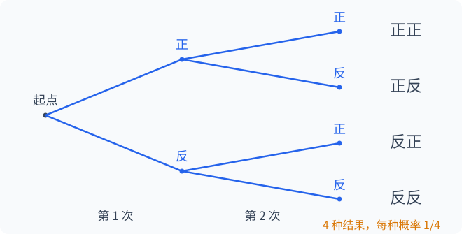

两次掷均匀硬币，共有 $4$ 种等可能结果，恰好一次正面有 $2$ 种，概率为 $\frac24=\frac12$

### 4. 放回与不放回 {#replacement .knowledge-title}

| 抽取规则 | 第二次能否再抽到同一个球 | $4$ 个不同球抽两次的有序结果数 |
| --- | --- | --- |
| 放回、混匀 | 能 | $4\times4=16$ |
| 不放回 | 不能 | $4\times3=12$ |

同色球也要按不同个体编号，才能正确列举等可能结果

### 5. “或”“且”与对立事件 {#logic .knowledge-title}

- “A 或 B”：至少有一个发生，重叠的结果只数一次
- “A 且 B”：两个都发生
- “A 不发生”与“A 发生”合起来是全部结果，所以 $P(\text{A 不发生})=1-P(A)$

### 6. 用频率估计概率 {#frequency .knowledge-title}

频率是已经发生的次数占试验总次数的比例。条件相同时，大量重复试验的频率通常在某个值附近波动，可用来估计概率

例如多次掷均匀硬币，正面朝上的频率通常在 $0.5$ 附近波动，每一小批不一定恰好一半

## 【考点】先方法，再看例题 {#exam .handbook-section .is-exam}

### 1. 几何概率：均匀的是哪一种量 {#geometric .exam-title}

在线段或区域内任取点，通常有无限多个可选位置，不能数图上画出的几个标点。采用相应的均匀模型时：

| 选择机制 | 概率 |
| --- | --- |
| 沿线段均匀取点 | 目标长度／总长度 |
| 在有效平面区域内均匀落点 | 目标面积／总面积 |
| 指针按转角均匀停下 | 目标转角／周角 |

先把目标条件转为区间或图形，再与允许区域取交集，最后计算比值。转盘上同心等角扇区可用面积比，但任意形状的等面积色块不一定对应等转角。

这里的均匀性是模型条件，不是由“任意”两个字自动保证的现实规律。例如飞镖若明显偏向中心，仅靠面积比不够。本页相应题按均匀有效落点、均匀转角的教材模型计算。

连续模型还有一个边界：单个点的长度或面积为0，但这不表示图形里没有这个点。不能把有限模型中“概率0即没有有利结果”的推断不加区分地搬过来。

### 2. 公平游戏：单轮与最终胜负 {#fairness .exam-title}

在机会、成本、奖励相同的题设下，通常以双方获胜概率相同判断机会公平。无平局且一定分出胜负时，公平意味着双方各为 $1/2$；有平局时，单轮双方胜率可以同为 $1/3$，其余 $1/3$ 是平局。

若规定平局后恢复原状重开，“本轮直接获胜”与“整场最终获胜”是不同事件。计算最终概率时要把平局后继续游戏的机会算进去。若重开时不恢复原牌、混匀方式或规则，就不能当成同一个试验。胜率相等也不保证少量游戏恰好各赢同样次数，更不涵盖奖励、成本不同的全部现实公平问题。

### 3. 先用条件判断事件类型 {#classify .exam-title}

必然要说明为何所有允许结果都满足；不可能要找出与条件冲突的依据；随机要同时想到能发生和不能发生的情形。题问“确定性”时，必然与不可能都要选。

<article class="handbook-example" aria-labelledby="example-1">

#### 例题 01 确定性不只包括必然 知识清单例题 {#example-1 .example-heading}

题目

下列事件: ① 在足球比赛中, 弱队战胜强队; ② 抛掷一枚硬币, 落地后正面朝上; ③ 任取两个正整数, 其和大于 1; ④ 长分别为 3 厘米、5 厘米、9 厘米的三条线段能围成一个三角形. 其中确定性事件有 ____.

答案与解析

解析

①弱队可能战胜强队，也可能不胜；②硬币可能正面，也可能反面，都是随机事件。③两个正整数都至少为1，和至少为2，所以必大于1，是必然事件。④因为 $3+5=8<9$，不能组成三角形，是不可能事件。

本题结论

③④。

</article>

<article class="handbook-example" aria-labelledby="example-2">

#### 例题 02 用定理而非生活印象判断 2024 湖北 {#example-2 .example-heading}

题目

在下列事件中,必然事件是 ( )

A. 掷一次骰子, 向上一面的点数是 3

B. 篮球队员在罚球线上投篮一次, 未投中

C. 经过有交通信号灯的路口, 遇到红灯

D.任意画一个三角形,其内角和是 $180^{\circ}$

答案与解析

解析

A骰子可以出现3点，也可以出现其他点；B罚篮可以中，也可以不中；C路口可以遇到红灯，也可以遇到其他灯，均为随机事件。D在平面几何中由三角形内角和定理保证，必然成立。

本题结论

D。

</article>

### 4. 按等可能个体计数，而非按类别均分 {#one-step .exam-title}

先确定一次选取的实际对象和总数，再把目标类别内的个体数相加。同一袋中比较可能性，只需比较球数；不同题的袋中组成不能混用。

<article class="handbook-example" aria-labelledby="example-3">

#### 例题 03 比较三色球的机会 知识清单例题 {#example-3 .example-heading}

题目

一个布袋里装有2个红球、3个黑球、4个白球,它们除颜色外都相同,从中任意摸出1个球,则下列事件中,发生的可能性最大的是 ( )

A.摸出的是白球

B.摸出的是黑球

C.摸出的是红球

D.摸出的是绿球

答案与解析

解析

总数为 $2+3+4=9$。白、黑、红、绿的概率依次为 $4/9,3/9,2/9,0$，最大的是白球。没有绿球，因此摸出绿球不是“小概率”，而是不可能。

本题结论

A。

</article>

<article class="handbook-example" aria-labelledby="example-4">

#### 例题 04 由给定概率识别颜色 2024 辽宁 {#example-4 .example-heading}

题目

一个不透明袋子中装有 4 个白球,3 个红球,2 个绿球,1 个黑球,每个球除颜色外都相同.从中随机摸出一个球,则下列事件发生的概率为 $\frac{3}{10}$ 的是 ( )

A.摸出白球

B.摸出红球

C. 摸出绿球

D.摸出黑球

答案与解析

解析

总数为 $4+3+2+1=10$。白球概率 $4/10=2/5$，红球 $3/10$，绿球 $2/10=1/5$，黑球 $1/10$。只有红球符合，不能把四种颜色都当作 $1/4$。

本题结论

B。

</article>

<article class="handbook-example" aria-labelledby="example-5">

#### 例题 05 四个等机会选项 2024 广东 {#example-5 .example-heading}

题目

长江是中华民族的母亲河，长江流域孕育出藏羌文化、巴蜀文化、荆楚文化、吴越文化等区域文化。若从上述四种区域文化中随机选一种文化开展专题学习，则选中“巴蜀文化”的概率是（）

A. $\frac{1}{4}$

B. $\frac{1}{3}$

C. $\frac{1}{2}$

D. $\frac{3}{4}$

答案与解析

解析

从题目列出的四种文化中等可能选一种，共4种结果，选中巴蜀文化只有1种，因此为 $1/4$。$1/3$ 漏掉一个选项，$1/2$ 不符合四选一，$3/4$ 则是未选中的概率。

本题结论

A。

</article>

<article class="handbook-example" aria-labelledby="example-6">

#### 例题 06 先列组合，再验三角形 知识清单例题 {#example-6 .example-heading}

题目

有4根细木棒,长度分别为2 cm,3 cm,4 cm,5 cm,从中任选3根,恰好能搭成一个三角形的概率是____.

答案与解析

解析

从四根中任选三根，等价于等可能遗漏其中一根，共四组。按长度排序，只需检查短两边和是否严格大于最长边：

| 三根长度（cm） | 检验 | 能否成三角形 |
| --- | --- | --- |
| 2、3、4 | $2+3>4$ | 能 |
| 2、3、5 | $2+3=5$ | 不能 |
| 2、4、5 | $2+4>5$ | 能 |
| 3、4、5 | $3+4>5$ | 能 |

四种等可能组合有三种符合，概率为 $3/4$。等号时三点共线，不是三角形。

本题结论

$\frac34$。

</article>

### 5. 两步列举：区分先后与放回 {#two-step .exam-title}

给两个位置分别记第一次、第二次，先列完整有序结果，再按目标筛选。先后交换即使颜色一样，也可能是两条不同路径；不放回时删去同一个体重复的对角格。

<article class="handbook-example" aria-labelledby="example-7">

#### 例题 07 两枚硬币与两次摸球 知识清单例题 {#example-7 .example-heading}

题目

填空.

(1) 抛掷两枚质地均匀的硬币所能产生的全部结果为

____，其中一枚硬币正面向上、一枚硬币反面向上的概率为____。

(2)不透明袋子中装有蓝、绿小球各一个,除颜色外无其他差别.随机摸出一个小球后,放回并摇匀,再随机摸出一个,两次所得小球颜色的全部结果为

____,其中两次摸到的小球颜色相同的概率为____.

答案与解析

解析

（1）区分第一枚和第二枚，四种等可能结果是正正、正反、反正、反反。一正一反包含中间两种，所以概率为 $2/4=1/2$。

（2）放回并摇匀后，第二次仍可摸到蓝球或绿球。四种等可能结果是蓝蓝、蓝绿、绿蓝、绿绿，同色包含蓝蓝、绿绿两种，概率为 $1/2$。两次抽取合起来才是这里的一次完整试验。

本题结论

（1）正正、正反、反正、反反；$\frac12$。（2）蓝蓝、蓝绿、绿蓝、绿绿；$\frac12$。

</article>

<article class="handbook-example" aria-labelledby="example-8">

#### 例题 08 只有一个红球，也能连续摸到红球 2024 北京 {#example-8 .example-heading}

题目

不透明袋子中仅有红、黄小球各一个，两个小球除颜色外无其他差别。从中随机摸出一个小球，放回并摇匀，再从中随机摸出一个小球，则两次摸出的都是红球的概率是（）

A. $\frac{1}{4}$

B. $\frac{1}{3}$

C. $\frac{1}{2}$

D. $\frac{3}{4}$

答案与解析

解析

放回并摇匀后，原来的红球重新参与第二次抽取。四种等可能路径为红红、红黄、黄红、黄黄，只有红红满足两次都是红球，所以为 $1/4$。$1/3$ 是误把混色两条路径并成一类后均分，$1/2$ 只考虑一次，$3/4$ 是补事件。

本题结论

A。

</article>

<article class="handbook-example" aria-labelledby="example-9">

#### 例题 09 不放回后，分母随规则改变 知识清单例题 {#example-9 .example-heading}

题目

有四个完全一样的小球,分别标上数字1,2,3,4,再放到一个不透明的口袋中.若从口袋中随机摸出一个小球后不放回,接着再随机摸出一个小球,则两次摸出的小球上的数字之和为奇数的概率是 ( )

A. $\frac{1}{2}$

B. $\frac{1}{3}$

C. $\frac{2}{3}$

D. $\frac{3}{4}$

答案与解析

解析

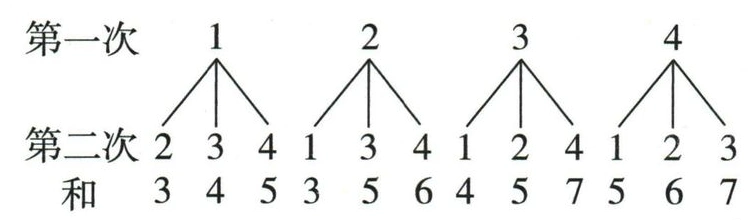

第一次4种选择，第二次剩3种，共 $4\times3=12$ 种等可能结果。和为奇数须一奇一偶：先奇后偶有 $2\times2=4$ 种，先偶后奇也有4种，共8种。因此 $P=8/12=2/3$。

也可列6组无序两球组合，其中4组一奇一偶，得到 $4/6$；不可把4个无序有利组合除以12条有序路径。A的 $1/2$ 对应误用了放回模型；B是同奇偶的补事件。

本题结论

C。

</article>

<article class="handbook-example" aria-labelledby="example-10">

#### 例题 10 两次掷骰子，和不是等可能的类别 知识清单示例 {#example-10 .example-heading}

题目

将一枚质地均匀的正方体骰子掷两次，求得到点数之和是7的概率。

答案与解析

解析

以第一次点数为列，第二次点数为行，列出两点之和：

| 第二次＼第一次 | 1 | 2 | 3 | 4 | 5 | 6 |
| --- | --- | --- | --- | --- | --- | --- |
| 1 | 2 | 3 | 4 | 5 | 6 | 7 |
| 2 | 3 | 4 | 5 | 6 | 7 | 8 |
| 3 | 4 | 5 | 6 | 7 | 8 | 9 |
| 4 | 5 | 6 | 7 | 8 | 9 | 10 |
| 5 | 6 | 7 | 8 | 9 | 10 | 11 |
| 6 | 7 | 8 | 9 | 10 | 11 | 12 |

36格代表36种等可能有序结果。和为7的有 $(1,6),(2,5),(3,4),(4,3),(5,2),(6,1)$，共6种，所以为 $6/36=1/6$。和为2只有一格，和为7有六格，因此不能把2至12这11个和均分。

本题结论

$\frac16$。

</article>

### 6. “或”去重，补事件减少计数 {#union-complement .exam-title}

先固定同一个等可能结果表，再逐格标记“至少满足一个条件”。分别计数时须减掉重叠；若目标复杂而反面简单，可用1减去补事件概率。

<article class="handbook-example" aria-labelledby="example-11">

#### 例题 11 两条件同时满足，也只算一次 知识清单例题 {#example-11 .example-heading}

题目

如图,让两个转盘(转盘被等分成四个扇形区域,指针的位置是固定的)分别自由转动一次,当转盘停止转动时,两个指针分别落在某两个数所表示的区域内,则这两个数的和是2的倍数或3的倍数的概率等于()

A. $\frac{3}{16}$

B. $\frac{3}{8}$

C. $\frac{5}{8}$

D. $\frac{13}{16}$

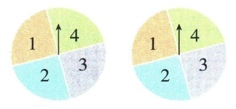

答案与解析

解析

两盘各四种结果，共16种等可能有序结果。两数之和如下：

| 第一数＼第二数 | 1 | 2 | 3 | 4 |
| --- | --- | --- | --- | --- |
| 1 | 2 | 3 | 4 | 5 |
| 2 | 3 | 4 | 5 | 6 |
| 3 | 4 | 5 | 6 | 7 |
| 4 | 5 | 6 | 7 | 8 |

和为2的倍数有8格，和为3的倍数有5格；和为6的3格同时满足，重复数了一遍，所以有利结果数为 $8+5-3=10$，概率为 $10/16=5/8$。

D的 $13/16$ 重复计算交集；A的 $3/16$ 只取了“且”；B的 $3/8$ 对应6格，漏掉结果。

本题结论

C。

</article>

<article class="handbook-example" aria-labelledby="example-12">

#### 例题 12 积为偶数，先数“两数都奇” 知识清单示例 {#example-12 .example-heading}

题目

一个不透明的袋子中有四张除数字外完全相同的卡片，分别标上数字1、2、3、4。随机抽取一张，放回后搅匀，再随机抽取一张。求两次抽到的数字之积为偶数的概率。

答案与解析

解析

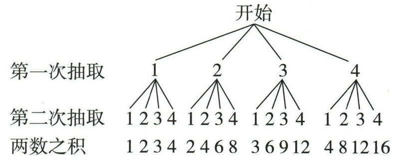

放回并搅匀后，共 $4\times4=16$ 种等可能有序结果。积为奇数必须两数都在1、3中，共 $(1,1),(1,3),(3,1),(3,3)$ 四种。其余 $16-4=12$ 种的积为偶数，所以概率为 $12/16=3/4$。

树图下方的乘积是路径的计算值，不是第三次抽取。若改成不放回，路径总数和有利数都要重算。

本题结论

$\frac34$。

</article>

### 7. 多步传球：每次从当前持球者出发 {#passing .exam-title}

初始持球不算一次传球；每传一次，树向下增加一层。每个节点只连向当前持球者以外的两人，再数末端符合条件的完整路径，不把末端人名当作等可能类别。

<article class="handbook-example" aria-labelledby="example-13">

#### 例题 13 可以隔步回到自己，不能直接传给自己 知识清单例题 {#example-13 .example-heading}

题目

A、B、C三人玩篮球传球游戏,游戏规则:第一次传球由A将球随机地传给B、C两人中的某一人,之后的每一次传球都是由上次的接球者将球随机地传给其他两人中的某一人.

(1) 求两次传球后, 球恰在 B 手中的概率.  
(2) 求三次传球后, 球恰在 A 手中的概率.

答案与解析

解析

（1）两次传球有四条等可能路径：$A\to B\to A$、$A\to B\to C$、$A\to C\to A$、$A\to C\to B$。只有最后一条末端为B，概率为 $1/4$。

（2）每条路径再向当前持球者以外的两人扩展，共8条等可能路径。回到A的只有 $A\to B\to C\to A$ 与 $A\to C\to B\to A$，故概率为 $2/8=1/4$。

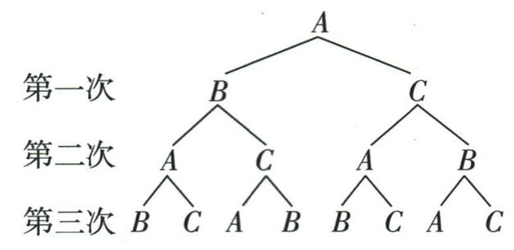

本题结论

（1）$\frac14$；（2）$\frac14$。

</article>

### 8. 连续区域先求范围，再取度量比 {#geometry-method .exam-title}

明确均匀落点或转角的模型；求出目标范围并截在允许区域内。长度比、面积比、转角比不能互相随意替代。题设板外或边界重投时，分母按有效落点区域计算。

<article class="handbook-example" aria-labelledby="example-14">

#### 例题 14 数轴上任取一点 知识清单例题 {#example-14 .example-heading}

题目

如图, 数轴上有两点 A、B, 在线段 AB 上任取一点 C, 则点 C 到表示 1 的点的距离不大于 2 的概率是 ____.

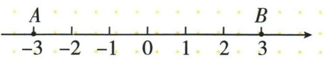

答案与解析

解析

原图 $A=-3,B=3$，总长度为6。设C的坐标为 $x$，则 $|x-1|\le2$，解得 $-1\le x\le3$。与允许区间 $[-3,3]$ 取交集仍为 $[-1,3]$，长度为4。

按沿线段均匀取点模型，概率为 $4/6=2/3$。C可以在任意位置，不是只从七个整数标点中抽取。

本题结论

$\frac23$。

</article>

<article class="handbook-example" aria-labelledby="example-15">

#### 例题 15 飞镖板上的阴影面积 知识清单例题 {#example-15 .example-heading}

题目

如图,飞镖游戏板中每一个小正方形除颜色外都相同.若某人向游戏板投掷飞镖一次(若飞镖落在游戏板外或阴影边界线上则重新投掷),则飞镖落在阴影部分的概率是()

A. $\frac{1}{2}$

B. $\frac{1}{3}$

C. $\frac{4}{9}$

D. $\frac{5}{9}$

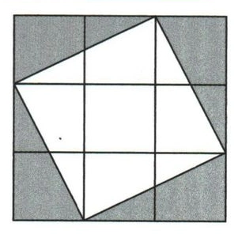

答案与解析

解析

以每小格边长为1，则整板面积为 $3\times3=9$。四角阴影分别是底为2、高为1的三角形，每块面积为 $\frac12\times2\times1=1$，总阴影面积为4。

按有效落点在板内均匀分布的模型，概率为 $4/9$。D的 $5/9$ 是白色区域的概率；板外重投，不能把板外区域加入分母。

本题结论

C。

</article>

<article class="handbook-example" aria-labelledby="example-16">

#### 例题 16 正八边形的中心转角 2024 江苏苏州 {#example-16 .example-heading}

题目

如图, 正八边形转盘被分成八个面积相等的三角形, 任意转动这个转盘一次, 当转盘停止转动时, 指针落在阴影部分的概率是 ____.

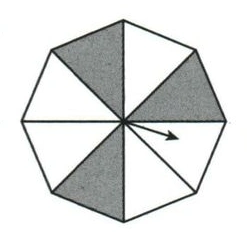

答案与解析

解析

中心连各顶点，把周角等分成八份，每份角度为 $360^\circ/8=45^\circ$。阴影占三份转角，均匀转动模型下的概率为 $3/8$。

此图等面积三角形也对应等转角，才可直接数份数；不能由此推出任何转盘的任意面积比都是指针概率。

本题结论

$\frac38$。

</article>

### 9. 由概率精确求数，由频率作估计 {#inverse .exam-title}

设未知颜色球数，分母写袋中全部球数。先分清给定的是理论概率还是试验频率，再列方程或估计关系；最后检验整数条件，并回答真正所问的数量。

<article class="handbook-example" aria-labelledby="example-17">

#### 例题 17 黄球数与总球数不是同一个答案 知识清单例题 {#example-17 .example-heading}

题目

一个不透明的袋子里装有除颜色外都相同的3个白色乒乓球和若干个黄色乒乓球,若从这个袋子里随机摸出一个乒乓球,恰好是黄球的概率为 $\frac{7}{10}$ ,则袋子内乒乓球的总个数为____.

答案与解析

解析

设黄球有 $x$ 个，则

$$\frac{x}{x+3}=\frac7{10}\quad\Longrightarrow\quad10x=7x+21\quad\Longrightarrow\quad x=7.$$

$x=7$ 为非负整数，分母 $x+3=10$ 不为0，且原概率确为 $7/10$。所求是总数，故为 $7+3=10$。也可用白球概率 $1-7/10=3/10$，求总数 $3\div(3/10)=10$。

本题结论

10个。

</article>

<article class="handbook-example" aria-labelledby="example-18">

#### 例题 18 摸球频率只能反求估计值 知识清单例题 {#example-18 .example-heading}

题目

在不透明的口袋中有若干个红色小球,现放入10个白色小球,这些小球除颜色外无其他差别,均匀混合后,有放回地随机摸取30次,有10次摸到白色小球,据此估计该口袋中原有红色小球的个数为____.

答案与解析

解析

白球的观测频率为 $10/30=1/3$。设原有红球 $x$ 个，用频率估计白球概率，有

$$\frac{10}{x+10}\approx\frac13\quad\Longrightarrow\quad x+10\approx30\quad\Longrightarrow\quad x\approx20.$$

这不是证明袋中真实红球数必为20；有限30次抽取可能有波动。放回并混匀使各次抽取的条件保持一致，30是试验次数，不是已知的袋内总数。

本题结论

估计原有红球约20个。

</article>

### 10. 频率表和折线图：分子分母逐列配对 {#estimate .exam-title}

每列用本列事件频数除以本列试验次数；按横轴次数、纵轴频率描点连接。结合大样本附近的摆动和要求的精确度作估计，不把最后一列当作已证明的精确概率。

<article class="handbook-example" aria-labelledby="example-19">

#### 例题 19 补频率表并画折线图 知识清单例题 {#example-19 .example-heading}

题目

下面是同学们做“抛掷质地均匀的硬币”试验获得的数据.

| 抛掷次数n | 100 | 200 | 300 | 400 | 500 |
| --- | --- | --- | --- | --- | --- |
| 正面朝上的频数m | 51 | 98 | 153 | 200 | 255 |
| 正面朝上的频率 $\frac{m}{n}$ |  |  |  |  |  |

(1) 完成表格.   
(2) 在图中画出折线图.  
(3) 抛掷质地均匀的硬币, 正面朝上的概率的估计值是多少? (精确到 0.1)

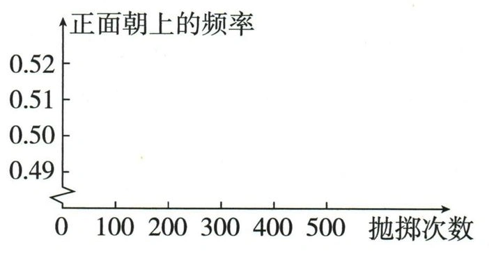

答案与解析

解析

（1）五列分别为

| 抛掷次数 | 频率计算 | 结果 |
| --- | --- | --- |
| 100 | $51/100$ | 0.51 |
| 200 | $98/200$ | 0.49 |
| 300 | $153/300$ | 0.51 |
| 400 | $200/400$ | 0.50 |
| 500 | $255/500$ | 0.51 |

（2）按 $(100,0.51),(200,0.49),(300,0.51),(400,0.50),(500,0.51)$ 描点并依次连接，完成图如下。

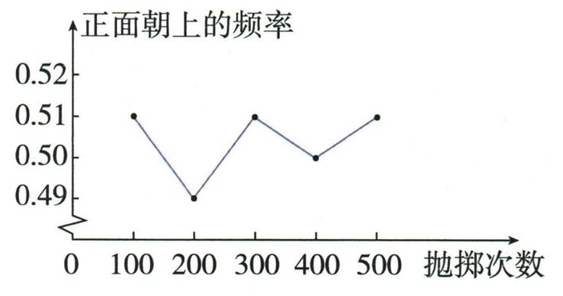

（3）频率在0.5附近摆动，精确到0.1估计为0.5。注意400次时频率为0.50，500次反而为0.51，已经说明“次数增加就必更接近”不成立。

本题结论

（1）0.51、0.49、0.51、0.50、0.51；（2）见折线图；（3）0.5。

</article>

<article class="handbook-example" aria-labelledby="example-20">

#### 例题 20 瓶盖有两面，不等于两面各一半 2024 江苏扬州 {#example-20 .example-heading}

题目

数学兴趣小组做抛掷一枚瓶盖的试验后,整理的试验数据如下表:

| 累计抛掷次数 | 50 | 100 | 200 | 300 | 500 | 1 000 | 2 000 | 3 000 | 5 000 |
| --- | --- | --- | --- | --- | --- | --- | --- | --- | --- |
| 盖面朝上次数 | 28 | 54 | 106 | 157 | 264 | 527 | 1 056 | 1 587 | 2 650 |
| 盖面朝上频率 | 0.560 | 0.540 | 0.530 | 0.523 | 0.528 | 0.527 | 0.528 | 0.529 | 0.530 |

根据以上试验数据可以估计出“盖面朝上”的概率为____。(精确到0.01)

答案与解析

解析

后几组频率为0.527、0.528、0.529、0.530，约在0.53附近。依题精确到0.01，估计概率为0.53。

瓶盖两面的形状不同，只有两个结果名称不能证明等可能，不能未经分析就给出 $1/2$。估计值来自试验数据，而不是用样本最后一列“证明”理论值。

本题结论

0.53。

</article>

### 11. 先还原统计人数，再确定抽样范围 {#statistics-link .exam-title}

用同一类别的频数与占比还原调查总数，再补齐目标档的实际人数。求概率时只对真正参与抽取的人员编号；调查总数与候选人数是两个不同的分母。

<article class="handbook-example" aria-labelledby="example-21">

#### 例题 21 从劳动时间E档中选两名学生 知识清单例题 {#example-21 .example-heading}

题目

为贯彻教育部《大中小学劳动教育指导纲要(试行)》文件精神,某学校举办“我参与,我劳动,我快乐,我光荣”活动.为了解学生周末在家劳动情况,学校随机调查了八年级部分学生在家劳动时间(单位:小时),并进行整理和分析(劳动时间x分成五档,A档:0≤x<1;B档:1≤x<2;C档:2≤x<3;D档:3≤x<4;E档:x≥4),调查的八年级男生、女生劳动时间的不完整统计图如下.

(1)本次调查中,共调查了____名学生,补全条形图.   
(2)学校为了提高学生的劳动意识,现从 E 档中选两名学生进行劳动经验交流,请用列表法或画树状图法求所选两名学生恰好都是女生的概率.

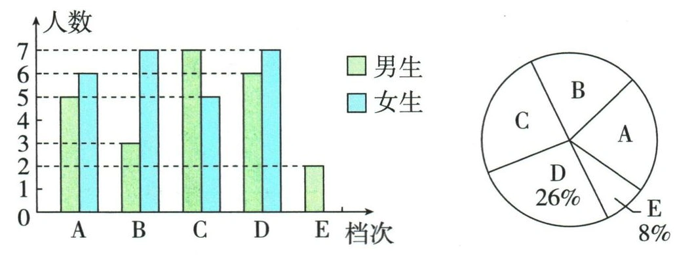

答案与解析

解析

（1）D档男生6人、女生7人，合13人，占26%，调查总数为

$$(6+7)\div26\%=50\text{（人）}.$$

E档占8%，共 $50\times8\%=4$ 人，其中男生2人，所以女生为2人；在E档补一根高度为2的女生条形。

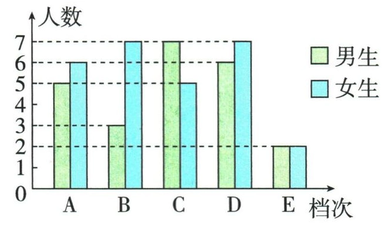

（2）只从E档四人选，编号男1、男2、女1、女2，按不放回的先后顺序列表：

| 第一名＼第二名 | 男1 | 男2 | 女1 | 女2 |
| --- | --- | --- | --- | --- |
| 男1 | — | 男1男2 | 男1女1 | 男1女2 |
| 男2 | 男2男1 | — | 男2女1 | 男2女2 |
| 女1 | 女1男1 | 女1男2 | — | 女1女2 |
| 女2 | 女2男1 | 女2男2 | 女2女1 | — |

共12条等可能路径，恰好两名女生的只有女1女2、女2女1两条，所以为 $2/12=1/6$。同一人不能选两次，两个女生也不能因性别相同而并成一个人。

本题结论

（1）50人，E档女生条形高为2；（2）$\frac16$。

</article>

### 12. 公平游戏：先分胜负，再核重开规则 {#game-method .exam-title}

列全等可能路径，按双方胜与平局分类。没有平局时比较双方胜率；需要设计公平规则，就把路径均分为两类。平局重开时先算单轮，再说明最终结果，不能把两种概率混写。

<article class="handbook-example" aria-labelledby="example-22">

#### 例题 22 五等分与四等分转盘的公平规则 知识清单例题 {#example-22 .example-heading}

题目

如图所示,小吴和小黄在玩转盘游戏,准备了两个可以自由转动的转盘甲、乙,每个转盘被分成面积相等的几个扇形区域,并在每个扇形区域内标上数字,游戏规则:同时转动两个转盘,当转盘停止转动后(如果指针恰好指在分割线上,那么重转一次,直到指针指向某一扇形区域),指针所指扇形区域内的数字之和为4或5或6时,小吴胜;否则小黄胜.

(1) 这个游戏规则对双方公平吗?  
(2)请你设计一个对双方都公平的游戏规则.

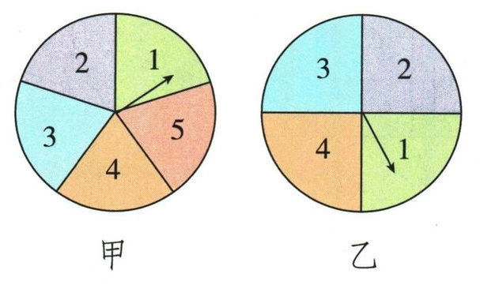

答案与解析

解析

（1）甲有1至5五种等机会结果，乙有1至4四种等机会结果，独立转动共20种。两数和为4有 $(1,3),(2,2),(3,1)$ 三种；和为5有四种；和为6也有四种，所以小吴赢的有 $3+4+4=11$ 种，小黄赢的有9种。

$$P(\text{小吴胜})=\frac{11}{20},\qquad P(\text{小黄胜})=\frac9{20}.$$

两者不等，因此不公平。

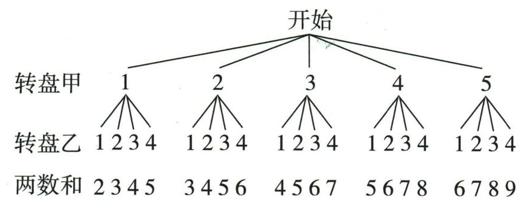

（2）可改为：和为奇数，小吴胜；和为偶数，小黄胜。固定甲的任一数，乙的1至4中有两个数使和为奇、两个使和为偶，因此五行各贡献两种，双方都为 $10/20=1/2$，公平。此规则覆盖全部结果且没有平局。

本题结论

原规则不公平；可改为和奇、和偶分别获胜，双方各 $\frac12$。

</article>

<article class="handbook-example" aria-labelledby="example-23">

#### 例题 23 平局重开后的最终胜率 2024 山东青岛 {#example-23 .example-heading}

题目

学校拟举办庆祝“中华人民共和国成立 75 周年”文艺汇演,每班选派一名志愿者.九年级一班的小明和小红都想参加,于是两人决定一起做“摸牌”游戏,获胜者参加.规则如下:将牌面数字分别为 1,2,3 的三张纸牌(除牌面数字外,其余都相同)背面朝上,洗匀后放在桌面上,小明先从中随机摸出一张,记下数字后放回并洗匀,小红再从中随机摸出一张,若两次摸到的数字之和大于 4,则小明胜;若和小于 4,则小红胜;若和等于 4,则重复上述过程.

(1) 小明从三张纸牌中随机摸出一张, 摸到“1”的概率是 ____.  
(2)请用列表或画树状图的方法,说明这个游戏对双方是否公平.

答案与解析

解析

（1）三张牌等可能抽到，摸到1的概率为 $1/3$。

（2）放回并洗匀后，9种等可能结果的和为：

| 小明＼小红 | 1 | 2 | 3 |
| --- | --- | --- | --- |
| 1 | 2 | 3 | 4 |
| 2 | 3 | 4 | 5 |
| 3 | 4 | 5 | 6 |

和大于4有 $(2,3),(3,2),(3,3)$ 三种，和小于4有 $(1,1),(1,2),(2,1)$ 三种，和等于4也有三种。因此单轮小明直接胜、小红直接胜、平局的概率各为 $1/3$，双方机会对称。

若设按规则一直重开直到决胜时，小明的最终胜率为 $q$：第一轮直接胜的概率为 $1/3$；第一轮平局的概率为 $1/3$，恢复原状后仍面对相同问题，最终胜率仍为 $q$。所以

$$q=\frac13+\frac13q\quad\Longrightarrow\quad q=\frac12.$$

小红同理为 $1/2$。连续 $k$ 轮全平的概率为 $(1/3)^k$，随轮数增加趋近0，因而不存在需要分给第三方的最终“平局胜率”。

单轮直接获胜的概率 $1/3$，与整场最终获胜的概率 $1/2$ 不同；两种口径下双方机会都相等，所以公平判断不变。

本题结论

（1）$\frac13$；（2）公平。单轮双方直接胜各 $\frac13$，最终胜各 $\frac12$。

</article>

## 【坑点】具体错法与边界 {#pitfalls .handbook-section .is-pitfall}

### 1. 少见不是不可能，概率不承诺短期次数 {#short-run .pitfall-title}

常见错法： 三颗骰子全为6很少见，就说不可能；硬币正面概率为一半，就断言两次必有一次正面。

错因与自查： 区分“有无允许结果”与“结果机会大小”。写出正正、反反即可反驳两次必有一次正面；不要用概率乘次数，代替实际发生次数。

<article class="handbook-example is-pitfall" aria-labelledby="pitfall-1">

#### 辨析 01 四种概率说法逐项辨析 2024 江苏连云港 {#pitfall-1 .example-heading}

题目

下列说法正确的是 ( )

A.10 张票中有 1 张奖票, 10 人去摸, 先摸的人摸到奖票的概率较大

B.从1,2,3,4,5中随机抽取一个数,取得偶数的可能性较大

C. 小强一次掷出 3 颗质地均匀的骰子, 3 颗全是 6 点朝上是随机事件

D. 抛一枚质地均匀的硬币, 正面朝上的概率为 $\frac{1}{2}$ , 连续抛此硬币 2 次必有 1 次正面朝上

答案与解析

解析

A：在充分混匀、每人只摸一次且事先未获知他人结果的模型中，奖票等可能位于10个抽取位置，人人事先中奖概率均为 $1/10$，先摸不更大。获知前面的实际结果后，条件概率可能改变，不能与事先比较混淆。

B：五数中偶数2个、奇数3个，抽到偶数的概率 $2/5$ 小于奇数的 $3/5$。

C：三颗骰子全为6既能发生，也能不发生，是随机事件。

D：两次可出现正正、正反、反正、反反，可能出现0、1或2次正面，并非必有一次。

本题结论

C。

</article>

<article class="handbook-example is-pitfall" aria-labelledby="pitfall-2">

#### 辨析 02 命中率不是固定次数表 2024 贵州 {#pitfall-2 .example-heading}

题目

小星同学通过大量重复的定点投篮练习,用频率估计他投中的概率为 0.4,下列说法正确的是()

A. 小星定点投篮 1 次, 不一定能投中

B. 小星定点投篮 1 次, 一定可以投中

C. 小星定点投篮 10 次, 一定投中 4 次

D. 小星定点投篮 4 次, 一定投中 1 次

答案与解析

解析

0.4表示投中仍有可能，也有可能投不中，所以单次“不一定投中”正确。B的“一定”把随机说成必然；C把概率强行变成十次恰四次；D也没有依据。投中可能性小于未投中，不表示下一次必不中。

本题结论

A。

</article>

### 2. 类别同名，不代表等可能或独立 {#independence .pitfall-title}

常见错法： 三种颜色各占三分之一；两个学生各自入A班概率为三分之一，就推断两人入班互不影响。

错因与自查： 类别内个体数可能不同，固定名额还会被前一个人占用。先问“哪些具体对象等机会”，再问“前一步是否改变后一步候选”。[劳动选人例题](#example-21)展示了同名个体必须编号；下面的分班题则需要审查模型。

<article class="handbook-example is-pitfall" aria-labelledby="pitfall-3">

#### 辨析 03 人数相同与独立分班不是一回事 2024 江西 · 条件辨析改编 {#pitfall-3 .example-heading}

题目

某校一年级开设人数相同的 A, B, C 三个班级, 甲、乙两位学生是该校一年级新生, 开学初学校对所有一年级新生进行电脑随机分班.

(1)“学生甲分到 A 班”的概率是 ____.  
(2)请用画树状图法或列表法,求甲、乙两位新生分到同一个班的概率.

条件辨析：第（2）问请分别讨论“甲乙各自独立、等可能选择班级”和“每班严格固定 $s$ 个名额，共 $3s$ 名学生均匀分配”两种机制，并说明原题中的“人数相同”为什么需要进一步解释。

答案与解析

解析

（1）三班对称随机，甲进入A班的概率为 $1/3$。

（2）题目同时写“人数相同”与“电脑随机”，但没有说明是否严格固定各班最终人数。先按甲乙分别独立、等可能选择班级的模型处理：

| 甲＼乙 | A | B | C |
| --- | --- | --- | --- |
| A | AA | AB | AC |
| B | BA | BB | BC |
| C | CA | CB | CC |

在这一模型下9格等可能，同班为AA、BB、CC三格，概率为 $1/3$。

但若“人数相同”表示每班严格固定 $s$ 个名额，共 $3s$ 人均匀分配，给定甲已占一个名额，剩余 $3s-1$ 个名额中，与甲同班的只有 $s-1$ 个。因此

$$P(\text{同班})=\frac{s-1}{3s-1},$$

并非 $1/3$。三班的单人入班机会相同，不足以保证两人独立。

原题未给班额也未明确分配机制，不能擅自指定人数得到具体分数；这里保留原独立模型答案，同时说明固定等人数模型下须用另一公式。

本题结论

（1）$\frac13$；（2）独立模型为 $\frac13$，固定每班 $s$ 人模型为 $\frac{s-1}{3s-1}$，原题机制需澄清。

</article>

### 3. “放回”、 “或”和计数口径不能混用 {#counting-check .pitfall-title}

常见错法： 不放回删掉重复球，却仍用16作分母；把“或”直接相加；一组无序组合除以有序路径总数。

自查： 给具体个体编号；逐步更新候选；把总结果和有利结果用同一种记法列出。“或”只在重叠区计一次，“且”只取重叠区。[不放回摸球](#example-9)与[双转盘倍数](#example-11)分别给出可核查的反例。树状图的叶子只是末端，真正计数的是从根到叶的整条路径。

### 4. 频率会摆动，估计不变成精确值 {#estimate-boundary .pitfall-title}

常见错法： 30次有10次摸白，就断定红球必有20个；400次频率达到0.50，就断定500次会更近；瓶盖有两面，就各为一半。

自查： 标明信息来自理论模型还是样本；估计结论保留“约”。[硬币表](#example-19)中400次为0.50、500次为0.51就是摆动反例。[瓶盖](#example-20)的0.53由数据估计，不能用两个名称代替等可能性证明。

### 5. 面积、长度、转角及整场范围各有边界 {#model-boundary .pitfall-title}

常见错法： 数轴只数整数点；转盘只看任意色块面积；平局重开后仍把最终胜率写成单轮的三分之一。

自查： 写明均匀选择的是哪一种量，再写目标所在的有效范围。[数轴取点](#example-14)用长度，不是整数数目；[八边形转盘](#example-16)依赖中心等角；[平局重开](#example-23)要分别列单轮胜、平、负与最终胜负。不要丢掉限定词后照搬一个正确分数。
