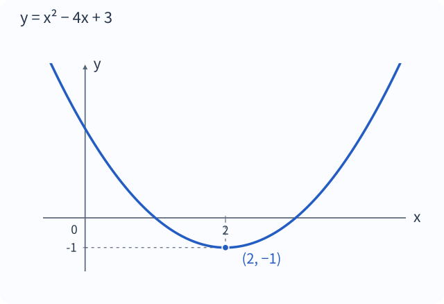

求值域的方法：直接法、配方法、单调性法、换元法、分离常数法、基本不等式法、构造复合法。

## 考点 配方法 {#completing-square .note-heading .note-heading--exam data-note-type="exam"}

用于二次函数或含二次式的函数。

1. 配成顶点式 $y=a(x-h)^2+k$
2. 结合定义域，看顶点和对称轴的位置
3. 比较顶点、端点处的函数值，确定最值
4. 结合图像写出值域

<article class="handbook-example" aria-labelledby="example-01">

#### 例题 01 配方法 原笔记 {#example-01 .example-heading}

求函数 $y=x^2-4x+3$ 的值域。

笔记过程

1. 配方：$y=(x-2)^2-1$
2. 开口向上，顶点为 $(2,-1)$
3. 值域为 $[-1,+\infty)$

</article>

## 考点 单调性法 {#monotonicity .note-heading .note-heading--exam data-note-type="exam"}

1. 确定定义域
2. 判断函数的单调性
3. 计算端点处的函数值

## 考点 换元法 {#substitution .note-heading .note-heading--exam data-note-type="exam"}

适用于含根式、指数、对数等表达式的函数。

1. 选取换元式，确定新变量 $t$ 的范围
2. 把原函数写成 $y=f(t)$
3. 在 $t$ 的范围内求 $f(t)$ 的值域

<article class="handbook-example" aria-labelledby="example-02">

#### 例题 02 根式换元 原笔记 {#example-02 .example-heading}

求函数 $y=x+\sqrt{1-x}$ 的值域。

笔记过程

1. 令 $t=\sqrt{1-x}$，则 $t\ge0$
2. 由 $x=1-t^2$，得到 $y=-t^2+t+1$
3. 在 $t\ge0$ 的范围内，用配方法求值域

</article>

## 考点 分离常数法 {#separating-constant .note-heading .note-heading--exam data-note-type="exam"}

对一次式比一次式、二次式比二次式等分式，尝试化为“常数＋反比例函数”的形式。

1. 分离出常数
2. 确定余下分式中分母的取值范围
3. 利用反比例函数的性质求值域

<article class="handbook-example" aria-labelledby="example-03">

#### 例题 03 分离常数 原笔记 {#example-03 .example-heading}

求函数 $y=\dfrac{2x+1}{x-1}$ 的值域，其中 $x\ne1$。

笔记过程

$$
y=\frac{2(x-1)+3}{x-1}=2+\frac3{x-1}
$$

$\frac3{x-1}\ne0$，所以 $y\ne2$，值域为

$$
(-\infty,2)\cup(2,+\infty)
$$

</article>

## 考点 基本不等式法 {#inequality .note-heading .note-heading--exam data-note-type="exam"}

适用于经分离常数、换元后，能写成下式的分式：

$$
y=at+\frac bt+c\qquad(ab>0)
$$

1. 将分母中的一次式整体换元
2. 整理成对勾型函数的形式
3. 利用基本不等式或对勾型函数的性质求值域

<article class="handbook-example" aria-labelledby="example-04">

#### 例题 04 基本不等式法 原笔记 {#example-04 .example-heading}

求函数 $y=\dfrac{x^2+x+1}{x+1}$ 的值域，其中 $x\ne-1$。

笔记过程

令 $t=x+1$，则 $x=t-1$、$t\ne0$。

$$
y=\frac{(t-1)^2+(t-1)+1}{t}=t+\frac1t-1
$$

- $t>0$ 时，$y\ge2-1=1$
- $t<0$ 时，$y\le-2-1=-3$

值域为

$$
(-\infty,-3]\cup[1,+\infty)
$$

</article>

## 考点 构造复合法 {#composition .note-heading .note-heading--exam data-note-type="exam"}

用于复合函数的值域或最值问题。

1. 求原函数的定义域，确定内函数 $u=g(x)$
2. 求内函数在这个定义域内的值域 $D$
3. 以 $u$ 为自变量，考察外函数 $f(u)$
4. 在 $D$ 内求 $f(u)$ 的值域

<article class="handbook-example" aria-labelledby="example-05">

#### 例题 05 构造复合函数 原笔记 {#example-05 .example-heading}

求函数 $y=\sqrt{x^2-4}$ 的值域。

笔记过程

1. 由 $x^2-4\ge0$，得 $x\le-2$ 或 $x\ge2$
2. 内函数 $u=x^2-4$ 的值域为 $D=[0,+\infty)$
3. 外函数 $y=\sqrt u$ 的定义域与 $D$ 的交集为 $[0,+\infty)$
4. $u=0$ 时，$y$ 的最小值为 $0$；$u$ 增大时，$y$ 趋于 $+\infty$

所以原函数的值域为 $[0,+\infty)$。

</article>
