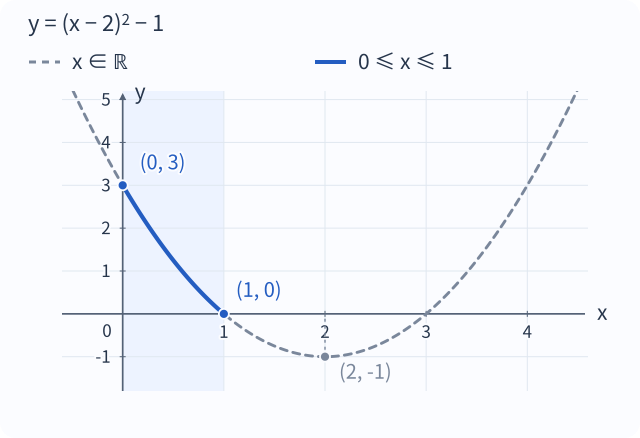

## 知识点 值域是函数值能取到的所有值 {#meaning .note-heading .note-heading--knowledge data-note-type="knowledge"}

函数的定义域为 $D$ 时，值域就是

$$
\{f(x)\mid x\in D\}
$$

先看 $x$ 能取哪些值，再求对应的 $y$。同一个表达式，定义域不同，值域也可能不同。

区间端点能取到，用方括号；取不到，用圆括号。$+\infty$ 和 $-\infty$ 两侧总用圆括号。

## 考点 直接法：从熟悉的函数读值域 {#direct .note-heading .note-heading--exam data-note-type="exam"}

表达式简单时，先用已知的基本函数值域，再看加减、倍乘等变化。例如 $x^2$ 和 $\sqrt{x}$ 的值域都是 $[0,+\infty)$，而 $2^x$ 的值域是 $(0,+\infty)$；这里都取各自的自然定义域。

<article class="handbook-example" aria-labelledby="example-01">

#### 例题 01 直接求值域 原创 {#example-01 .example-heading}

求函数 $y=2^x+1$ 的值域，其中 $x\in\mathbb R$。

答案与解析

$2^x$ 的值域为 $(0,+\infty)$，整体加 $1$ 后，值域变为 $(1,+\infty)$。

检验：若 $y=1$，就要求 $2^x=0$，没有实数解；任意 $y>1$ 都对应一个正数 $y-1$，而 $2^x$ 可以取到这个正数。

</article>

指数函数的图像与性质可回看[指数函数](./指数函数.md)。

## 考点 配方法：看顶点与边界 {#completing-square .note-heading .note-heading--exam data-note-type="exam"}

二次函数先写成顶点式：

$$
y=a(x-h)^2+k\qquad(a\ne0)
$$

当 $x\in\mathbb R$ 时：

| 条件 | 值域 | 边界在哪里取到 |
| --- | --- | --- |
| $a>0$ | $[k,+\infty)$ | $x=h$ 时取最小值 $k$ |
| $a<0$ | $(-\infty,k]$ | $x=h$ 时取最大值 $k$ |

定义域受限时，先看顶点能否取到，再看区间边界处的函数值。

<article class="handbook-example" aria-labelledby="example-02">

#### 例题 02 配方求值域 原笔记 {#example-02 .example-heading}

求函数 $y=x^2-4x+3$ 的值域，其中 $x\in\mathbb R$。

答案与解析

配方得

$$
y=(x-2)^2-1
$$

因为 $(x-2)^2\ge0$，所以 $y\ge-1$；$x=2$ 时等号成立。

反过来，任取 $y\ge-1$，令 $x=2+\sqrt{y+1}$ 就能得到该函数值。因此值域为 $[-1,+\infty)$。

</article>

如果把定义域改成 $[0,1]$，图像就只保留蓝色一段，值域变为 $[0,3]$。顶点 $(2,-1)$ 不在这一段，不能再把 $-1$ 当作最小值。

## 考点 单调性法：看区间两端 {#monotonicity .note-heading .note-heading--exam data-note-type="exam"}

对一次函数、指数函数等连续函数，若它在给定区间上严格单调，就可以沿图像从一端读到另一端，确定全部函数值。

递增时，左端对应较小的值；递减时，情况相反。还要分清端点是否包含在定义域内。

<article class="handbook-example" aria-labelledby="example-03">

#### 例题 03 由单调性求值域 原创 {#example-03 .example-heading}

求函数 $y=2^x$ 在 $x\in[-1,2)$ 上的值域。

答案与解析

左端 $x=-1$ 可以取到，对应 $y=\frac12$；右端 $x=2$ 不能取到，函数值只能接近 $4$。

因为 $2^x$ 在这个区间连续、递增，所以它取遍从 $\frac12$ 到 $4$ 之间的所有值，值域为

$$
\left[\frac12,4\right)
$$

检验：$x=-1$ 时确有 $y=\frac12$；区间内始终有 $x<2$，故 $y<4$。

</article>

## 考点 换元法：先求新变量的范围 {#substitution .note-heading .note-heading--exam data-note-type="exam"}

根式、指数等部分反复出现，或换元后能化成二次式时，可以令这部分为 $t$。先写清 $t$ 的范围，再求新函数的值域。

<article class="handbook-example" aria-labelledby="example-04">

#### 例题 04 根式换元求值域 原笔记 {#example-04 .example-heading}

求函数 $y=x+\sqrt{1-x}$ 的值域。

答案与解析

原函数的定义域为 $(-\infty,1]$。令 $t=\sqrt{1-x}$，则 $t$ 可以取遍 $[0,+\infty)$，且

$$
y=1-t^2+t=\frac54-\left(t-\frac12\right)^2
$$

$t=\frac12$ 在允许范围内，此时 $x=\frac34$，函数取最大值 $\frac54$。

当 $t$ 从 $\frac12$ 向 $+\infty$ 增大时，$y$ 从 $\frac54$ 连续减小且没有下界。因此值域为

$$
\left(-\infty,\frac54\right]
$$

检验：$x=\frac34$ 时，$y=\frac34+\frac12=\frac54$。

</article>

### 坑点 换元后要保留取值范围 {.note-heading .note-heading--pitfall data-note-type="pitfall"}

反例（原创）：对 $y=x-\sqrt{1-x}$，仍令 $t=\sqrt{1-x}\ge0$，得到

$$
y=1-t^2-t=\frac54-\left(t+\frac12\right)^2
$$

顶点对应 $t=-\frac12$，不在允许范围内。实际最大值为 $1$，在 $t=0$、$x=1$ 时取到，不能把 $\frac54$ 写成最大值。

## 考点 分离常数法：把分式拆开 {#separating-constant .note-heading .note-heading--exam data-note-type="exam"}

分子、分母都是一次式时，尝试写成“常数＋分式”。再看余下的分式能取哪些值。

<article class="handbook-example" aria-labelledby="example-05">

#### 例题 05 分离常数求值域 原笔记 {#example-05 .example-heading}

求函数 $y=\dfrac{2x+1}{x-1}$ 的值域，其中 $x\ne1$。

答案与解析

拆分得

$$
y=2+\frac3{x-1}
$$

$x-1$ 可以取遍所有非零实数，因此 $\frac3{x-1}$ 也可以取遍所有非零实数。于是 $y$ 可以取遍除 $2$ 以外的所有实数，值域为

$$
(-\infty,2)\cup(2,+\infty)
$$

检验：$y=2$ 要求 $\frac3{x-1}=0$，不可能；而对任意 $y\ne2$，取 $x=1+\frac3{y-2}$ 即可，且此时 $x\ne1$。

</article>

### 坑点 分式的值域不一定“只缺一个数” {.note-heading .note-heading--pitfall data-note-type="pitfall"}

上例中余下分式的分子为非零常数 $3$，这一步很关键。如果式子是

$$
y=\frac{2x-2}{x-1}=2\qquad(x\ne1)
$$

它的值域就是 $\{2\}$。先化简，再判断，不能只凭分式的外形套结论。

## 考点 基本不等式法：先看正负，再看等号 {#inequality .note-heading .note-heading--exam data-note-type="exam"}

换元、拆分后出现 $t+\frac1t$ 时，可按 $t$ 的正负分别处理：

| 条件 | 结论 | 等号条件 |
| --- | --- | --- |
| $t>0$ | $t+\frac1t\ge2$ | $t=1$ |
| $t<0$ | $t+\frac1t\le-2$ | $t=-1$ |

第一行由基本不等式得到；第二行可令 $s=-t>0$，对 $s+\frac1s$ 使用第一行，再取相反数。

<article class="handbook-example" aria-labelledby="example-06">

#### 例题 06 用基本不等式求值域 原笔记 {#example-06 .example-heading}

求函数 $y=\dfrac{x^2+x+1}{x+1}$ 的值域，其中 $x\ne-1$。

答案与解析

令 $t=x+1\ne0$，得到

$$
y=\frac{t^2-t+1}{t}=t+\frac1t-1
$$

- $t>0$ 时，$y\ge2-1=1$，等号在 $t=1$、$x=0$ 时成立
- $t<0$ 时，$y\le-2-1=-3$，等号在 $t=-1$、$x=-2$ 时成立

还要确认这两个区间内的值都能取到。令函数值为 $r$，则

$$
t^2-(r+1)t+1=0
$$

当且仅当判别式 $(r+1)^2-4\ge0$，即 $r\le-3$ 或 $r\ge1$ 时，有实数解。根的乘积为 $1$，所以这些解都满足 $t\ne0$。

因此值域为

$$
(-\infty,-3]\cup[1,+\infty)
$$

检验：代入原式，$x=-2$ 得 $y=-3$，$x=0$ 得 $y=1$，两个端点均能取到。

</article>

用基本不等式时，不能只写一个界：还要核对正负条件、等号能否在原定义域内成立，以及区间内的值是否都能取到。

## 考点 复合法：把内层的值域交给外层 {#composition .note-heading .note-heading--exam data-note-type="exam"}

对 $y=F(g(x))$，先求内层 $u=g(x)$ 实际能取到的范围，再在这个范围内研究 $y=F(u)$。

<article class="handbook-example" aria-labelledby="example-07">

#### 例题 07 由内层范围求值域 原笔记 {#example-07 .example-heading}

求函数 $y=\sqrt{x^2-4}$ 的值域。

答案与解析

由 $x^2-4\ge0$ 得 $x\le-2$ 或 $x\ge2$，定义域为

$$
(-\infty,-2]\cup[2,+\infty)
$$

在这个定义域内，内层 $u=x^2-4$ 可以取遍 $[0,+\infty)$；外层 $y=\sqrt u$ 也可以取遍 $[0,+\infty)$。

所以原函数的值域为 $[0,+\infty)$。

检验：$x=\pm2$ 时，$y=0$；对任意 $r\ge0$，取 $x=\sqrt{r^2+4}$，就有 $\sqrt{x^2-4}=r$，没有遗漏任何非负数。

</article>

换元法侧重把表达式化简，复合法侧重把内层范围传给外层；同一道题可以结合使用。
