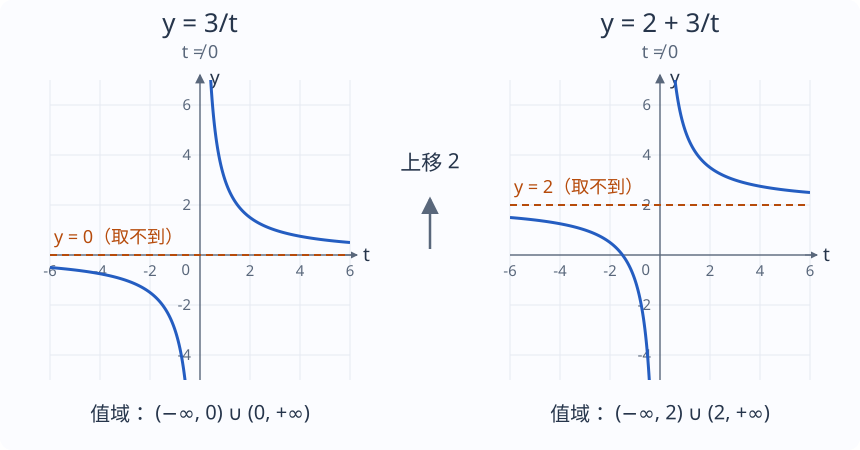
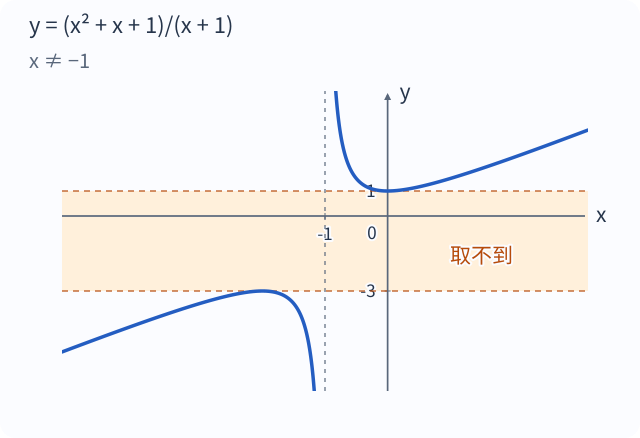

求值域的方法：直接法、配方法、单调性法、换元法、分离常数法、基本不等式法、构造复合法。

## 考点 配方法 {#completing-square .note-heading .note-heading--exam data-note-type="exam"}

用于二次函数或含二次式的函数。

以 $y=x^2-4x+3$（$x\in\mathbb R$）为例：

| 步骤 | 例子 |
| --- | --- |
| 1. 配成顶点式 | $y=(x-2)^2-1$ |
| 2. 确定顶点坐标和最值 | 顶点为 $(2,-1)$，最值为 $-1$ |
| 3. 看开口方向 | $a=1>0$，开口向上，$-1$ 是最小值 |
| 4. 写出值域 | $[-1,+\infty)$ |

### 坑点 定义域不允许 x=h {#vertex-domain .note-heading .note-heading--pitfall data-note-type="pitfall"}

如果 $h$ 不在定义域内，就不能直接把 $k$ 当作最值，要结合端点和允许范围内的图像重新判断。

## 考点 单调性法 {#monotonicity .note-heading .note-heading--exam data-note-type="exam"}

1. 确定定义域
2. 判断函数的单调性
3. 计算端点处的函数值

## 考点 换元法 {#substitution .note-heading .note-heading--exam data-note-type="exam"}

适用于含根式、指数、对数等表达式的函数。

以 $y=x+\sqrt{1-x}$ 为例：

| 步骤 | 例子 |
| --- | --- |
| 1. 换元，确定 $t$ 的范围 | 令 $t=\sqrt{1-x}$，则 $t\ge0$ |
| 2. 把原函数写成 $y=f(t)$ | 两边平方：$t^2=1-x$ 移项得：$x=1-t^2$ 代入原式：$y=(1-t^2)+t$ 整理得：$y=-t^2+t+1$ |
| 3. 在 $t$ 的范围内求值域 | 在 $t\ge0$ 的范围内，用配方法求值域 |

## 考点 分离常数法 {#separating-constant .note-heading .note-heading--exam data-note-type="exam"}

对一次式比一次式、二次式比二次式等分式，尝试化为“常数＋反比例函数”的形式。

以 $y=\dfrac{2x+1}{x-1}$（$x\ne1$）为例：

| 步骤 | 例子 |
| --- | --- |
| 1. 分离出常数 | 分母是 $x-1$，先凑出 $2(x-1)=2x-2$ 它比原分子 $2x+1$ 少 $3$，所以 $2x+1=2(x-1)+3$ $y=\dfrac{2(x-1)+3}{x-1}$ $\phantom{y}=\dfrac{2(x-1)}{x-1}+\dfrac3{x-1}$ 因为 $x\ne1$，第一项可以约分，得 $y=2+\dfrac3{x-1}$ |
| 2. 确定分母的取值范围 | $x$ 可以取除 $1$ 以外的所有实数 所以 $x-1$ 可以取除 $0$ 以外的所有实数 |
| 3. 利用反比例函数的性质求值域 | 分子是 $3$，所以 $\dfrac3{x-1}$ 不可能等于 $0$ 分母能取任意非零实数，因此这个分式也能取任意非零实数 $y=2+\dfrac3{x-1}$，即在非零实数上加 $2$ 所以 $y$ 只有 $2$ 取不到，其余实数都能取到 值域为 $(-\infty,2)\cup(2,+\infty)$ |

## 考点 基本不等式法 {#inequality .note-heading .note-heading--exam data-note-type="exam"}

适用于经分离常数、换元后，能写成下式的分式：

$$
y=at+\frac bt+c\qquad(ab>0)
$$

以 $y=\dfrac{x^2+x+1}{x+1}$（$x\ne-1$）为例：

| 步骤 | 例子 |
| --- | --- |
| 1. 将分母中的一次式整体换元 | 令 $t=x+1$ 则 $x=t-1$，且 $t\ne0$ |
| 2. 整理成对勾型函数的形式 | $y=\dfrac{(t-1)^2+(t-1)+1}{t}$ $\phantom{y}=\dfrac{t^2-t+1}{t}$ $\phantom{y}=t+\dfrac1t-1$ |
| 3. 利用基本不等式或对勾型函数的性质求值域 | $t>0$ 时，$t+\dfrac1t\ge2$，所以 $y\ge1$ $t<0$ 时，$t+\dfrac1t\le-2$，所以 $y\le-3$ 值域为 $(-\infty,-3]\cup[1,+\infty)$ |

## 考点 构造复合法（内值外定法） {#composition .note-heading .note-heading--exam data-note-type="exam"}

用于复合函数的值域或最值问题。

以 $y=\sqrt{x^2-4}$ 为例：

| 步骤 | 例子 |
| --- | --- |
| 1. 求定义域，确定内函数 | 由 $x^2-4\ge0$，得 $x\le-2$ 或 $x\ge2$ 内函数为 $u=x^2-4$ |
| 2. 求内函数在定义域内的值域 $D$ | 当 $x\le-2$ 或 $x\ge2$ 时，$u=x^2-4$ 的值域为 $D=[0,+\infty)$ |
| 3. 考察外函数 | 外函数是 $y=\sqrt u$，要求 $u\ge0$ 与 $D$ 取交集，得到 $u\in[0,+\infty)$ |
| 4. 在 $D$ 内求外函数的值域 | $u=0$ 时，$y$ 的最小值为 $0$ $u$ 增大时，$y$ 趋于 $+\infty$ 所以原函数的值域为 $[0,+\infty)$ |
