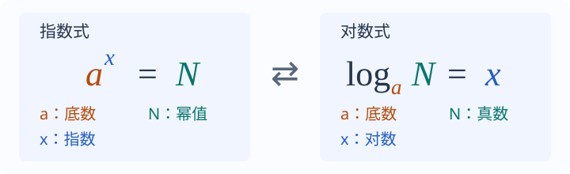

## 知识点 对数 {#definition .note-heading .note-heading--knowledge data-note-type="knowledge"}

如果 $a^x=N$，那么 $x$ 叫作以 $a$ 为底 $N$ 的==对数==，记作 $\log_a N=x$

$$
a^x=N\quad\Longleftrightarrow\quad\log_a N=x
$$

- 底数 $a$：$a>0$，且 $a\ne1$
- 真数 $N$：$N>0$
- 对数 $x$：就是指数式中的指数

例如：

- $2^4=16$，所以 $\log_2 16=4$
- $3^x=16$，所以 $x=\log_3 16$

## 考点 指数式与对数式互化 {#conversion .note-heading .note-heading--exam data-note-type="exam"}

底数不变，找清指数和幂值的位置

| 指数式 | 对数式 |
| --- | --- |
| $5^4=625$ | $\log_5 625=4$ |
| $2^{-6}=\dfrac1{64}$ | $\log_2\dfrac1{64}=-6$ |
| $\left(\dfrac12\right)^{-4}=16$ | $\log_{\frac12}16=-4$ |

## 考点 利用定义求真数、底数 {#calculation .note-heading .note-heading--exam data-note-type="exam"}

<article class="handbook-example" aria-labelledby="example-argument">

#### 例题 计算 $x$ {#example-argument .example-heading}

1. $\log_{64}x=-\dfrac23$
2. $\log_x8=6$

展开解析

1. 化成指数式：$x=64^{-\frac23}$ 因为 $64=2^6$，所以 $x=(2^6)^{-\frac23}=2^{-4}=\dfrac1{16}$
2. 底数要求 $x>0$，且 $x\ne1$ 化成指数式：$x^6=8=2^3$ 即 $(x^2)^3=2^3$，所以 $x^2=2$ 得到 $x=\pm\sqrt2$，但底数必须大于 $0$ 所以 $x=\sqrt2$

</article>

## 知识点 常用对数与自然对数 {#common-logarithm .note-heading .note-heading--knowledge data-note-type="knowledge"}

- 以 $10$ 为底的对数叫作==常用对数==，简记为 $\lg N$（$N>0$）
- 以 $e$ 为底的对数叫作==自然对数==，简记为 $\ln N$（$N>0$），其中 $e\approx2.71828$

| 名称 | 简写 | 完整写法 | 底数 |
| --- | --- | --- | --- |
| 常用对数 | $\lg N$ | $\log_{10}N$ | $10$ |
| 自然对数 | $\ln N$ | $\log_eN$ | $e$ |

### 考点 利用定义计算对数 {#natural-calculation .note-heading .note-heading--exam data-note-type="exam"}

<article class="handbook-example" aria-labelledby="example-log-calculation">

#### 例题 计算 $x$ {#example-log-calculation .example-heading}

1. $\lg100=x$
2. $\lg\dfrac1{10000}=x$
3. $\ln(e^3)=x$
4. $-\ln(e^2)=x$

展开解析

1. 化成指数式：$10^x=100=10^2$ 所以 $x=2$
2. 化成指数式：$10^x=\dfrac1{10000}=10^{-4}$ 所以 $x=-4$
3. 化成指数式：$e^x=e^3$ 所以 $x=3$
4. 两边取相反数：$\ln(e^2)=-x$ 化成指数式：$e^{-x}=e^2$ 所以 $-x=2$，得 $x=-2$

</article>

## 知识点 对数的基本性质 {#properties .note-heading .note-heading--knowledge data-note-type="knowledge"}

当 $a>0$，且 $a\ne1$ 时：

| 指数式 | 对数式 | 含义 |
| --- | --- | --- |
| $a^0=1$ | $\log_a1=0$ | $1$ 的对数是 $0$ |
| $a^1=a$ | $\log_aa=1$ | 底数自身的对数是 $1$ |
