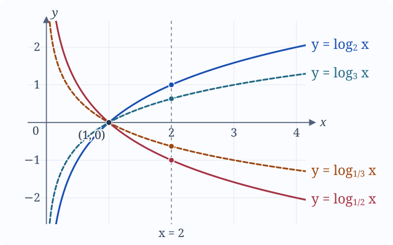
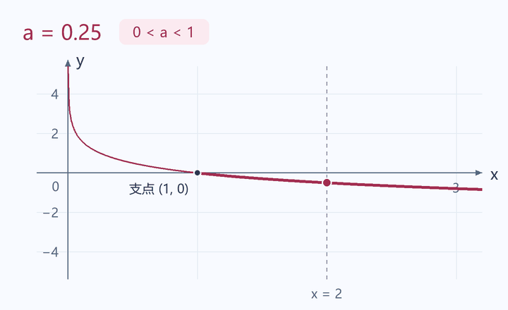

## 知识点 对数函数 {#definition .note-heading .note-heading--knowledge data-note-type="knowledge"}

形如 $y=\log_a x$ 的函数叫作==对数函数==

- 底数 $a$ 是常数，且 $a>0$、$a\ne1$
- 真数 $x$ 是自变量，$x>0$，定义域为 $(0,+\infty)$
- $\log_a x$ 前的系数是 $1$

## 知识点 图像与性质 {#graph-and-properties .note-heading .note-heading--knowledge data-note-type="knowledge"}

| 底数 | 在 $(0,+\infty)$ 上的单调性 |
| --- | --- |
| $0<a<1$ | 递减 |
| $a>1$ | 递增 |

- 值域为 $\mathbb R$，非奇非偶
- 图像都经过 $(1,0)$，因为 $\log_a1=0$
- 底数互为倒数时，两条图像关于 $x$ 轴对称

## 考点 求对数型函数的定点 {#fixed-point .note-heading .note-heading--exam data-note-type="exam"}

对于 $y=\log_a f(x)$，如果真数 $f(x)$ 不随底数 $a$ 变化，就令 $f(x)=1$

若解得 $x=x_0$，则 $y=\log_a1=0$，所以图像经过定点 $(x_0,0)$

## 知识点 底数 $a$ 对图像的影响 {#base-and-height .note-heading .note-heading--knowledge data-note-type="knowledge"}

把函数图像想象成一根弯棍，$(1,0)$ 是始终不动的支点。

<picture>
<source media="(prefers-reduced-motion: reduce)" srcset="./配图/对数函数-图像与性质.svg" />

</picture>

在支点右边，$0<a<1$ 的图像在横轴下方，$a>1$ 的图像在横轴上方。固定同一个 $x>1$（图中取 $x=2$），只在同一组底数里比较。

- $a$ 越小，右边翘得越高
- $a$ 越大，右边压得越低

## 考点 比较对数的大小 {#comparison .note-heading .note-heading--exam data-note-type="exam"}

| 两个对数的特点 | 比较方法 |
| --- | --- |
| 底数相同，真数不同 | 看这个对数函数的单调性 |
| 底数不同，真数不同 | 找合适的中间值，分别和它比较 |
| 底数不同，真数相同 | 用[换底公式](./对数.md#change-of-base)化为同底的对数再比较 |

## 考点 解对数不等式 {#inequality .note-heading .note-heading--exam data-note-type="exam"}

1. 先检查底数条件和真数范围
2. 化成同底，再根据单调性比较真数
3. 把结果与真数范围取交集

<article class="handbook-example" aria-labelledby="example-log-inequality">

#### 例题 解不等式 {#example-log-inequality .example-heading}

$\log_2(2x+3)\ge2$

展开解析

1. 真数要大于 $0$，所以 $2x+3>0$，即 $x>-\dfrac32$
2. 因为 $2=\log_2 4$，且底数 $2>1$，$\log_2 x$ 在定义域上递增，所以 $2x+3\ge4$，即 $x\ge\dfrac12$
3. 取交集，得 $x\ge\dfrac12$

</article>
