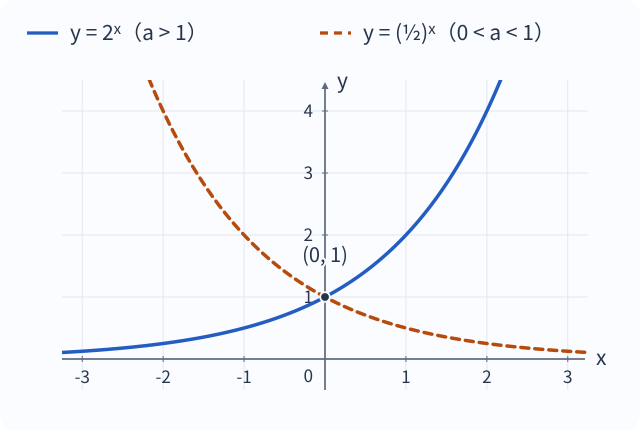

## 知识点 指数函数 {.note-heading .note-heading--knowledge data-note-type="knowledge"}

$$
y=a^x
$$

- 底数 $a$：常数，且 $a>0$、$a\ne1$
- 指数 $x$：自变量，$x\in\mathbb R$
- $a^x$ 前的系数：$1$

## 知识点 图像与性质 {.note-heading .note-heading--knowledge data-note-type="knowledge"}

| 底数 | 单调性 |
| --- | --- |
| $0<a<1$ | 递减 |
| $a>1$ | 递增 |

两类函数的共同性质：

- 定义域：$\mathbb R$
- 值域：$(0,+\infty)$
- 奇偶性：非奇非偶
- 定点：$(0,1)$；$x=0$ 时，$y=a^0=1$

## 知识点 指数型函数 {.note-heading .note-heading--knowledge data-note-type="knowledge"}

$$
f(x)=k\cdot a^x\qquad(k\ne0,\ a>0,\ a\ne1)
$$

- $x=0$ 时：$f(0)=k\cdot a^0=k$
- 相邻函数值之比：$\dfrac{f(n+1)}{f(n)}=\dfrac{k\cdot a^{n+1}}{k\cdot a^n}=a$

<article class="handbook-example" aria-labelledby="example-01">

#### 例题 01 指数式化简 {#example-01 .example-heading}

将 $y=4^{x+1}$ 写成 $k\cdot a^x$ 的形式。

笔记过程

$$
y=4^{x+1}=4^x\cdot4^1=4\cdot4^x
$$

</article>

## 知识点 图像的对称 {.note-heading .note-heading--knowledge data-note-type="knowledge"}

| 两个函数 | 图像关系 |
| --- | --- |
| $f(x)$ 与 $f(-x)$ | 关于 $y$ 轴对称 |
| $f(x)$ 与 $-f(x)$ | 关于 $x$ 轴对称 |

底数互为倒数的两个指数函数，其图像关于 $y$ 轴对称。

谁不变，就关于哪条轴对称。
