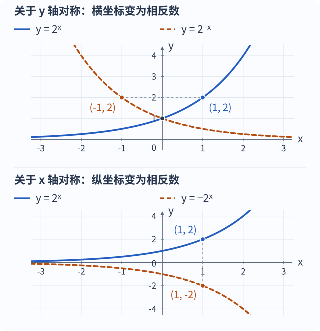

## 知识点 指数函数 {.note-heading .note-heading--knowledge data-note-type="knowledge"}

底数固定、指数是自变量的函数

$$
y=a^x\qquad(a>0,\ a\ne1)
$$

叫作指数函数，定义域为 $\mathbb R$。

这里的 $a$ 是常数，$x$ 是自变量，$a^x$ 前的系数为 $1$。例如 $y=2^x$、$y=\left(\frac12\right)^x$ 都是指数函数。

### 坑点 底数的限制不能漏 {.note-heading .note-heading--pitfall data-note-type="pitfall"}

- $a=1$：得到常函数 $y=1$，不属于这里定义的指数函数
- $a=0$：负指数没有意义，如 $0^{-1}$ 不存在
- $a<0$：不能让所有实数都作指数，如 $(-2)^{1/2}$ 在实数范围内没有意义

检查时先找底数，再核对 $a>0$ 且 $a\ne1$。

### 考点 判断是否为指数函数 {.note-heading .note-heading--exam data-note-type="exam"}

同时看三处：底数是否合法，指数是不是自变量，系数是否为 $1$。

<article class="handbook-example" aria-labelledby="example-01">

#### 例题 01 辨认指数函数 原创 {#example-01 .example-heading}

判断下列表达式是否表示指数函数：$y=x^2$，$y=2\cdot3^x$，$y=\left(\frac12\right)^x$，$y=(-2)^x$。

答案与解析

- $y=x^2$：自变量在底数位置，不是指数函数
- $y=2\cdot3^x$：系数为 $2$，属于指数型函数，不是这里定义的指数函数
- $y=\left(\frac12\right)^x$：底数大于 $0$ 且不等于 $1$，指数为自变量，系数为 $1$，是指数函数
- $y=(-2)^x$：底数为负，不能对所有实数 $x$ 定义，不符合指数函数的条件

</article>

## 知识点 图像与性质 {.note-heading .note-heading--knowledge data-note-type="knowledge"}

以 $y=2^x$ 和 $y=\left(\frac12\right)^x$ 为例，对照两类底数。

| 性质 | $a>1$ | $0<a<1$ |
| --- | --- | --- |
| 定义域 | $\mathbb R$ | $\mathbb R$ |
| 值域 | $(0,+\infty)$ | $(0,+\infty)$ |
| 单调性 | 递增 | 递减 |
| 与 $y$ 轴的交点 | $(0,1)$ | $(0,1)$ |
| 奇偶性 | 非奇非偶 | 非奇非偶 |

因为 $a^x>0$，图像始终在 $x$ 轴上方，不与 $x$ 轴相交；因为 $a^0=1$，图像都经过 $(0,1)$。

底数大于 $1$，自变量增大时函数值增大；底数在 $0$ 与 $1$ 之间，情况相反。图中只展示部分区间，曲线向两侧继续延伸。

### 考点 由单调性求底数范围 {.note-heading .note-heading--exam data-note-type="exam"}

先把“递增或递减”翻译成底数的范围，再解不等式。

<article class="handbook-example" aria-labelledby="example-02">

#### 例题 02 由递减求底数范围 原创 {#example-02 .example-heading}

若 $y=(m-1)^x$ 在 $\mathbb R$ 上递减，求实数 $m$ 的取值范围。

答案与解析

由递减得到

$$
0<m-1<1
$$

各项同时加 $1$，得 $1<m<2$。

检验：当 $1<m<2$ 时，底数 $m-1$ 为正且小于 $1$，满足指数函数的条件，并使函数递减。

</article>

### 考点 由图像上的点求底数 {.note-heading .note-heading--exam data-note-type="exam"}

把点的坐标代入 $y=a^x$，解出 $a$ 后检查底数条件。所有指数函数都经过 $(0,1)$，只知道这个点不能确定底数。

<article class="handbook-example" aria-labelledby="example-03">

#### 例题 03 由过点求底数 原创 {#example-03 .example-heading}

指数函数 $f(x)=a^x$ 的图像经过点 $(2,9)$。求 $a$ 和 $f(-1)$。

答案与解析

由 $a^2=9$ 及 $a>0$，得 $a=3$，所以

$$
f(-1)=3^{-1}=\frac13
$$

检验：$3>0$ 且 $3\ne1$，并且 $f(2)=3^2=9$。

</article>

## 知识点 指数型函数 {.note-heading .note-heading--knowledge data-note-type="knowledge"}

在 $a^x$ 前乘一个非零常数，得到指数型函数

$$
f(x)=ka^x\qquad(k\ne0,\ a>0,\ a\ne1)
$$

$k=1$ 时，就是指数函数。它有两个方便使用的关系：

| 关系 | 含义 |
| --- | --- |
| $f(0)=ka^0=k$ | 图像与 $y$ 轴交于 $(0,k)$ |
| $\dfrac{f(x+1)}{f(x)}=\dfrac{ka^{x+1}}{ka^x}=a$ | 自变量每增加 $1$，函数值乘以 $a$ |

例如 $y=4^{x+1}=4\cdot4^x$：它的 $k=4$、$a=4$，图像与 $y$ 轴交于 $(0,4)$。

### 考点 由两个函数值求参数 {.note-heading .note-heading--exam data-note-type="exam"}

已知相邻两个自变量对应的函数值时，先用后一个除以前一个求 $a$，再代入求 $k$。

<article class="handbook-example" aria-labelledby="example-04">

#### 例题 04 由函数值求参数 原创 {#example-04 .example-heading}

已知 $f(x)=ka^x$，其中 $k\ne0$、$a>0$ 且 $a\ne1$。若 $f(1)=6$、$f(2)=18$，求 $f(x)$ 和 $f(0)$。

答案与解析

由相邻函数值之比得

$$
a=\frac{f(2)}{f(1)}=\frac{18}{6}=3
$$

再由 $k\cdot3=6$，得 $k=2$。所以

$$
f(x)=2\cdot3^x,\qquad f(0)=2
$$

检验：$f(1)=2\cdot3=6$，$f(2)=2\cdot9=18$，且参数满足题设条件。

</article>

### 坑点 指数型函数的增减还要看系数 {.note-heading .note-heading--pitfall data-note-type="pitfall"}

$k>0$ 时，$ka^x$ 与 $a^x$ 的增减相同；$k<0$ 时，增减相反。

例如 $y=-3\cdot2^x$ 递减：$x$ 从 $0$ 增至 $1$，$y$ 从 $-3$ 减至 $-6$。判断时先看底数，再看系数的正负。

## 知识点 图像的对称变换 {.note-heading .note-heading--knowledge data-note-type="knowledge"}

| 新函数 | 改变什么 | 与原图像的关系 |
| --- | --- | --- |
| $y=f(-x)$ | 自变量变为相反数 | 关于 $y$ 轴对称 |
| $y=-f(x)$ | 函数值变为相反数 | 关于 $x$ 轴对称 |

以 $f(x)=2^x$ 为例，上图对照 $2^x$ 与 $2^{-x}$，下图对照 $2^x$ 与 $-2^x$。

特别地，底数互为倒数时，

$$
\left(\frac1a\right)^x=a^{-x}=f(-x)\qquad(f(x)=a^x)
$$

所以 $y=a^x$ 与 $y=\left(\frac1a\right)^x$ 的图像关于 $y$ 轴对称。

<article class="handbook-example" aria-labelledby="example-05">

#### 例题 05 判断图像的对称关系 原创 {#example-05 .example-heading}

函数 $f(x)=3^x$ 与 $g(x)=\left(\frac13\right)^x$ 的图像有什么关系？

答案与解析

因为

$$
g(x)=\left(\frac13\right)^x=3^{-x}=f(-x)
$$

两幅图像关于 $y$ 轴对称。例如 $f(1)=3$、$g(-1)=3$，对应点 $(1,3)$ 与 $(-1,3)$ 关于 $y$ 轴对称。

</article>
