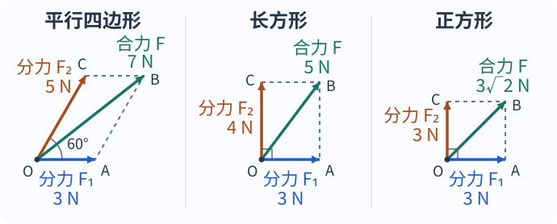
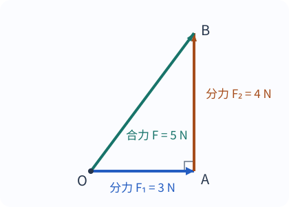
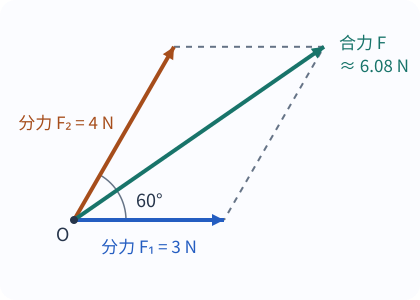
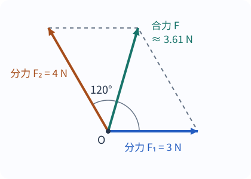
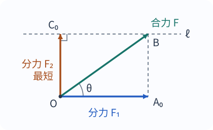
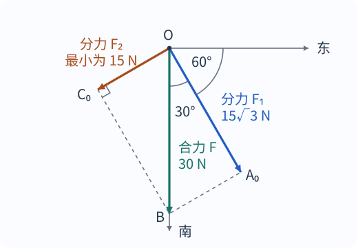

## 知识点 力的合成与分解 {#force-triangle .note-heading .note-heading--knowledge data-note-type="knowledge"}

两个力作用在同一物体上，作用线交于一点，就是共点力。能等效替代这两个力的力叫作==合力==，原来的两个力叫作它的==分力==，即 $\vec F=\vec F_1+\vec F_2$。

由分力求合力叫力的合成，由合力求分力叫力的分解。下面用两种画法，把合力 $\overrightarrow{OB}$ 沿指定的两个方向分解。

### 知识点 平行四边形定则 {#parallelogram-rule .note-heading .note-heading--knowledge data-note-type="knowledge"}

**把合力当作对角线。** 从 $O$ 沿两个分力方向画射线，过 $B$ 分别作这两条射线的平行线，补出平行四边形。两条邻边 $\overrightarrow{OA}$ 和 $\overrightarrow{OC}$ 分别表示分力 $\vec F_1$ 和 $\vec F_2$。

两个分力垂直时，图形是长方形。两力垂直且等大时，图形是正方形。

### 知识点 三角形定则 {#triangle-rule .note-heading .note-heading--knowledge data-note-type="knowledge"}

**把分力的箭头首尾相接。** 以中间的长方形为例，从 $O$ 沿 $\vec F_1$ 的方向画射线，过 $B$ 作平行于 $\vec F_2$ 的直线，交于 $A$。$\overrightarrow{OA}$ 是第一个分力，$\overrightarrow{AB}$ 是把第二个分力的箭头平移到 $A$ 后的画法。

对比夹角为 60° 和 120° 时的合力

两个分力仍为 $3\,\mathrm N$ 和 $4\,\mathrm N$，两张图按同一比例绘制。

两个分力的大小固定时，夹角越大，合力越小。

## 考点 求分力的最小值 {#minimum-component .note-heading .note-heading--exam data-note-type="exam"}

已知合力 $\vec F$ 和分力 $\vec F_1$ 的方向，二者夹角 $\theta$ 为锐角时，**以合力 $\overrightarrow{OB}$ 为对角线，沿 $\vec F_1$ 的方向作一边，构造矩形。**

过 $B$ 作平行于 $\vec F_1$ 的直线 $\ell$，从 $O$ 向 $\ell$ 作垂线，垂足为 $C_0$，补成矩形 $OA_0BC_0$。

由平行四边形定则，$\vec F_2$ 的终点都在 $\ell$ 上。垂线段 $OC_0$ 最短，又等于矩形的对边 $A_0B$，所以

$$
F_{2,\min}=OC_0=A_0B=F\sin\theta
$$

<article class="handbook-example" aria-labelledby="flatbed-example">

#### 例题 平板车的分力最小值 2026 年珠海实验中学期中 {#flatbed-example .example-heading}

一辆平板车原本静止在光滑水平地面上，在大小为 $30\,\mathrm N$ 的水平力 $\vec F$ 作用下开始向正南运动。现用两个水平共点力 $\vec F_1$、$\vec F_2$ 等效替代 $\vec F$。已知 $\vec F_1$ 的方向为东偏南 $60^\circ$，求 $F_2$ 的最小值。

A. $15\,\mathrm N$

B. $15\sqrt3\,\mathrm N$

C. $30\,\mathrm N$

D. $20\,\mathrm N$

展开解析

**构造矩形。** 车从静止向正南起动，合力 $\overrightarrow{OB}$ 指向正南。以 $OB$ 为对角线，沿东偏南 $60^\circ$ 作边 $OA_0$，另一条邻边 $OC_0$ 就表示最小的分力 $F_2$。

图中 $\angle A_0OB=90^\circ-60^\circ=30^\circ$。矩形两条对边等长，$OC_0=A_0B$，而 $A_0B$ 是 $30^\circ$ 的对边。

本题结论

$F_{2,\min}=OB\sin30^\circ=(30\,\mathrm N)\times\dfrac12=15\,\mathrm N$，选 **A**。

选项 B 的 $15\sqrt3\,\mathrm N$ 对应邻边 $OA_0$，是此时的 $F_1$。

</article>
