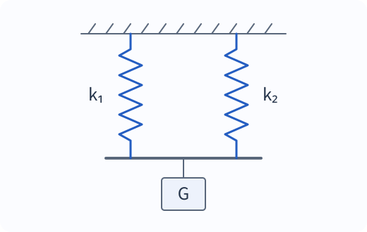
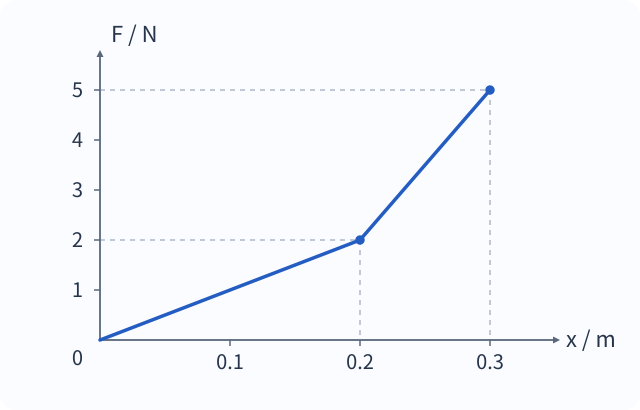
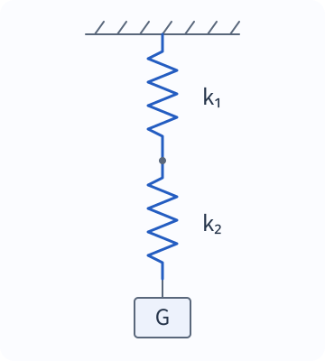

在弹性限度内，弹簧弹力的大小 $F=kx$；形变量改变时，$\Delta F=k\Delta x$。其中 $x$ 为伸长量或压缩量，$k$ 为劲度系数，单位是 $\mathrm{N/m}$。

以下忽略弹簧自重，连接件视为轻质，均在静止、形变未超过弹性限度时讨论。

## 知识点 弹簧的并联 {#parallel .note-heading .note-heading--knowledge data-note-type="knowledge"}

两根原长相同的弹簧，上端固定在同一高度，下端连接保持水平的轻杆。轻杆下挂重为 $G$ 的物体。

**并联时形变量相同，弹力相加。**

| 关系 | 推导 |
| --- | --- |
| 两根弹簧的伸长量相同 | $x_1=x_2=x$ |
| 对物体和轻杆整体受力分析 | $G=k_1x_1+k_2x_2=(k_1+k_2)x$ |
| 用一根弹簧等效替代 | $G=k_{\text{并}}x$ |

因此，两根弹簧并联的等效劲度系数为：

$$
k_{\text{并}}=k_1+k_2
$$

### 考点 求弹簧床中的弹簧根数 {#spring-bed .note-heading .note-heading--exam data-note-type="exam"}

一弹簧床垫由若干根完全相同的竖直弹簧并联支撑水平床面，每根弹簧的劲度系数 $k_0=10\,\mathrm{N/m}$。将重为 $100\,\mathrm N$ 的物体放在床面上，床面整体下降 $10\,\mathrm{cm}$。弹簧共有多少根？

| 选项 | 弹簧根数 |
| --- | --- |
| A | $20$ |
| B | $100$ |
| C | $200$ |
| D | $400$ |

| 步骤 | 计算 |
| --- | --- |
| 1. 统一单位 | $\Delta x=10\,\mathrm{cm}=0.10\,\mathrm m$ |
| 2. 求整体的等效劲度系数 | 新增压力 $\Delta F=100\,\mathrm N$ $k_{\text{并}}=\dfrac{\Delta F}{\Delta x}=\dfrac{100}{0.10}=1000\,\mathrm{N/m}$ |
| 3. 求弹簧根数 | $k_{\text{并}}=nk_0$ $n=\dfrac{1000}{10}=100$ |

答案为 **B**。

### 考点 从分段图像求劲度系数 {#piecewise-graph .note-heading .note-heading--exam data-note-type="exam"}

一根大弹簧内套着一根比它短 $0.2\,\mathrm m$ 的小弹簧，两根弹簧竖直放在水平地面上，下端齐平。竖直向下缓慢压缩大弹簧上端，压力 $F$ 与大弹簧压缩量 $x$ 的关系如图。大、小弹簧的劲度系数分别为 $k_1$、$k_2$，下列说法正确的是哪些？

| 选项 | 说法 |
| --- | --- |
| A | $k_1=5\,\mathrm{N/m}$ |
| B | $k_1=10\,\mathrm{N/m}$ |
| C | $k_2=10\,\mathrm{N/m}$ |
| D | $k_2=20\,\mathrm{N/m}$ |

**折点前只有大弹簧受压；折点后，两根弹簧共同受压，新增压缩量相同。**

| 阶段 | 计算 |
| --- | --- |
| $0\le x\le0.2\,\mathrm m$ | 小弹簧尚未被压缩，$F=k_1x$ $k_1=\dfrac{2}{0.2}=10\,\mathrm{N/m}$ |
| $0.2\,\mathrm m<x\le0.3\,\mathrm m$ | 两根弹簧共同承担新增压力，$\Delta F=(k_1+k_2)\Delta x$ $k_1+k_2=\dfrac{5-2}{0.3-0.2}=30\,\mathrm{N/m}$ $k_2=30-10=20\,\mathrm{N/m}$ |

答案为 **B、D**。

## 知识点 弹簧的串联 {#series .note-heading .note-heading--knowledge data-note-type="knowledge"}

两根弹簧首尾相连，上端固定，下端悬挂重为 $G$ 的物体。

**串联时弹力大小相等，总形变量等于各弹簧形变量之和。**

| 关系 | 推导 |
| --- | --- |
| 下方弹簧的弹力与重力平衡 | $G=k_2x_2$ |
| 忽略弹簧自重，上下弹簧弹力大小相等 | $G=k_1x_1=k_2x_2$ |
| 总伸长量相加 | $x=x_1+x_2=\dfrac{G}{k_1}+\dfrac{G}{k_2}$ |
| 用一根弹簧等效替代 | $G=k_{\text{串}}x$，即 $x=\dfrac{G}{k_{\text{串}}}$ |

因此，两根弹簧串联的等效劲度系数满足：

$$
\frac1{k_{\text{串}}}=\frac1{k_1}+\frac1{k_2}
\qquad\Longrightarrow\qquad
k_{\text{串}}=\frac{k_1k_2}{k_1+k_2}
$$

### 考点 求串联弹簧的总伸长量 {#series-extension .note-heading .note-heading--exam data-note-type="exam"}

轻弹簧 $P$ 上端固定，下端与轻弹簧 $Q$ 相连，$k_P=100\,\mathrm{N/m}$，$k_Q=200\,\mathrm{N/m}$。用 $40\,\mathrm N$ 的力竖直向下拉弹簧 $Q$ 的下端，静止时两根弹簧的总伸长量为 $\Delta x$。下列说法正确的是哪些？力改变后，弹簧仍在弹性限度内。

| 选项 | 说法 |
| --- | --- |
| A | $\Delta x=0.3\,\mathrm m$ |
| B | $\Delta x=0.6\,\mathrm m$ |
| C | 拉力增大一倍，静止时总伸长量也增大一倍 |
| D | 两根弹簧的等效劲度系数为 $\dfrac{k_Pk_Q}{k_P+k_Q}$ |

| 步骤 | 计算与判断 |
| --- | --- |
| 1. 分别求伸长量，再相加 | $\Delta x=\dfrac{F}{k_P}+\dfrac{F}{k_Q}=\dfrac{40}{100}+\dfrac{40}{200}=0.6\,\mathrm m$ A 错，B 对 |
| 2. 判断拉力改变后的总伸长量 | $\Delta x=F\left(\dfrac1{k_P}+\dfrac1{k_Q}\right)$ 劲度系数不变，总伸长量与拉力成正比，C 对 |
| 3. 等效为一根弹簧 | $\dfrac{F}{k_{\text{串}}}=\dfrac{F}{k_P}+\dfrac{F}{k_Q}$ $k_{\text{串}}=\dfrac{k_Pk_Q}{k_P+k_Q}$，D 对 |

答案为 **B、C、D**。
